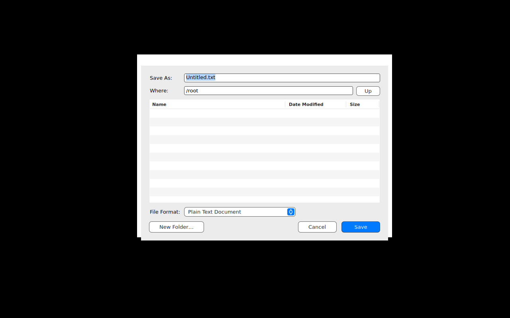

# TextEdit

A document-based application: `NSDocument` and `NSDocumentController` with plain-text,
Markdown and RTF documents, same source on macOS, Windows and Linux.



What it demonstrates:

- `TextDocument: NSDocument` overriding `read(from:ofType:)` and `data(ofType:)` (UTF-8
  text, or RTF through the port's `NSAttributedString(rtf:documentAttributes:)` and
  `rtf(from:documentAttributes:)`), and `makeWindowControllers()` building a window with an
  `NSTextView` in an `NSScrollView` and an `NSWindowController`.
- Document types from [Resources/TextEdit-Info.plist](Resources/TextEdit-Info.plist): `CFBundleDocumentTypes` with
  `LSItemContentTypes`, `CFBundleTypeExtensions`, `CFBundleTypeRole` and `NSDocumentClass`
  (`TextEdit.TextDocument`, resolved through the Swift runtime), plus a
  `UTImportedTypeDeclarations` entry for Markdown. Without a bundle, the port reads the
  plist named by `APPKITWIN_INFO_PLIST` or `Info.plist` next to the executable; `main.swift`
  sets the variable from the SwiftPM resource bundle (SwiftPM refuses a resource named
  `Info.plist`, hence the file's name) so `swift run TextEdit` works as is.
- The File menu wired through the responder chain: `newDocument:`, `openDocument:` and
  Open Recent (a submenu titled "Open Recent", filled by the document controller) reach
  `NSDocumentController.shared`; `performClose:`, `saveDocument:`, `saveDocumentAs:` and
  `revertDocumentToSaved:` reach the window, its controller and the document; `terminate:`
  reaches the application, which reviews unsaved documents first.
- The unsaved-changes alert (Save / Cancel / Don't Save) when an edited window closes or
  the application quits, the save panel as a sheet, "Untitled", "Untitled 2" names, the
  file name in the window title with the edited mark (a dot in the close button of the
  package-drawn title bar, an asterisk before the title in Windows and Linux title bars).
- Format > Make Rich Text / Make Plain Text switches the document type; the next save
  offers the matching extension.
- Files named on the command line open at launch; without any, an untitled document opens
  (`applicationShouldOpenUntitledFile`).

Each edit calls `updateChangeCount(.changeDone)` from the text view's change notification:
the port's `NSTextView` does not register undo actions yet, so the document's undo manager
(which would otherwise drive the change count, as on macOS) has nothing to count.

Run it:

```bash
swift run TextEdit
swift run TextEdit notes.txt                 # opens the file
swift run TextEdit --roundtrip out.rtf       # headless: make, write, reopen a document
APPKITWIN_FILE_DIALOG=package swift run TextEdit --show-save-panel   # the package-drawn panel
```

On Windows the panels are the common item dialogs; on Linux the xdg-desktop-portal
FileChooser when a portal runs, else the package-drawn panel (ADR-0017).
