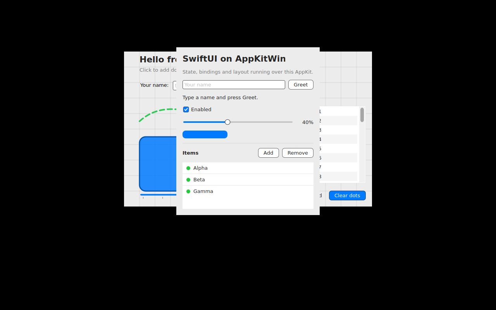
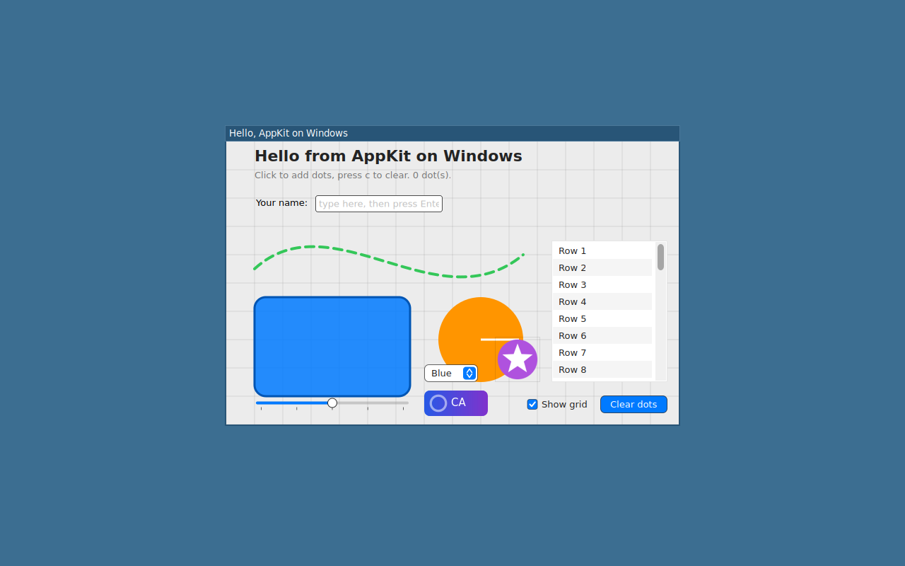

# AppKitWin

A source-compatible port of Apple's AppKit to Windows, written in Swift on top of
native Windows APIs (Win32, WinRT, DirectX 12, Direct2D, DirectWrite).

The long-term goal is a fully functioning SwiftUI stack on Windows. AppKit is the
first layer because SwiftUI on macOS is hosted by AppKit (`NSHostingView`,
`NSApplication`, the responder chain, `CALayer` trees). Linux is a planned
follow-on that reuses the platform-independent core with a different backend.

## Status

Pre-alpha. Milestone 1 ("open a window and draw into it") is in progress.
See [docs/ROADMAP.md](docs/ROADMAP.md) for milestones and
[docs/API-COVERAGE.md](docs/API-COVERAGE.md) for the generated coverage report.

## Getting started

Requirements: Swift 6.2 or newer. On macOS, Xcode 16 or the swift.org toolchain (the macOS
build is a headless host build used for type-checking and tests). On Windows 11, the
swift.org toolchain with Visual Studio Build Tools and the Windows 10/11 SDK. On Linux,
`swift:6.2-noble` or a 6.2 toolchain plus the Cairo, Pango, HarfBuzz, X11, Wayland and
xkbcommon development packages (`tools/linux/Dockerfile` lists them).

```bash
git clone https://github.com/medcelerate/AppKitWin.git
cd AppKitWin
swift build
swift run HelloWindow            # the AppKit sample: drawing, controls, menus, a glass window
swift run HelloWindow --swiftui  # opens the SwiftUI demo window too
swift test                       # on macOS; APPKITWIN_HOST_BACKEND=1 swift test on Windows and Linux
```

To use the package from your own app, add it as a dependency and import the modules by
their Apple names; code written for macOS compiles unchanged where the port covers it:

```swift
// Package.swift
dependencies: [.package(url: "https://github.com/medcelerate/AppKitWin.git", branch: "main")],
targets: [.executableTarget(name: "MyApp", dependencies: [
    .product(name: "AppKit", package: "AppKitWin"),
    .product(name: "SwiftUI", package: "AppKitWin"),
])]
```

```swift
import SwiftUI

@main
struct MyApp: App {
    var body: some Scene {
        WindowGroup("Hello") {
            VStack {
                Text("Hello from SwiftUI").font(.title)
                Button("Quit") { NSApplication.shared.terminate(nil) }
            }.padding()
        }
    }
}
```

```swift
import AppKit

final class AppDelegate: NSObject, NSApplicationDelegate {
    func applicationDidFinishLaunching(_ notification: Notification) {
        let window = NSWindow(contentRect: NSRect(x: 0, y: 0, width: 400, height: 300),
                              styleMask: [.titled, .closable, .resizable], backing: .buffered, defer: false)
        window.title = "Hello from AppKit"
        window.contentView = NSTextField(labelWithString: "Drawn by AppKitWin")
        window.center()
        window.makeKeyAndOrderFront(nil)
    }
}

let app = NSApplication.shared
let delegate = AppDelegate()
app.delegate = delegate
app.run()
```

Useful switches: `APPKITWIN_SOFTWARE_LAYERS=1` (software compositing instead of
DirectComposition on Windows), `APPKITWIN_LEGACY_TEXT=1` (the pre-CoreText text path on
Windows), `APPKITWIN_METAL_REFERENCE=1` (the CPU Metal device), `APPKITWIN_LINUX_BACKEND=x11|wayland`,
`APPKITWIN_HOST_BACKEND=1` (the headless backend the tests use). Side-by-side renderings
of the same windows on the three platforms are in [docs/comparisons.md](docs/comparisons.md).

## Layout

| Path | Purpose |
| --- | --- |
| `Sources/AppKit/Core` | Hand-written implementations of AppKit classes. |
| `Sources/AppKit/Generated` | Generated stubs for the public AppKit surface that compile today. Regenerate with `tools/apigen`. |
| `Sources/AppKit/Platform` | Backend protocols plus the Win32/DirectX backend and a headless host backend used for tests on macOS/Linux. |
| `Sources/CoreGraphics` | Windows implementation of the CoreGraphics drawing API over Direct2D (Windows only). |
| `Sources/CoreGraphics` (Windows only) | `CGContext`, `CGPath`, `CGColor` over Direct2D. |
| `Sources/Metal`, `Sources/MetalKit` | Metal's API as protocols with a CPU reference device and `MTKView`; the Direct3D 12 backend in `Sources/CMetalD3D12` (ADR-0004), used on Windows unless `APPKITWIN_METAL_REFERENCE=1`. |
| `Sources/AppKit/Platform/Linux`, `Sources/CCairo`, `Sources/CX11`, `Sources/CWayland` | Linux backend: Wayland (xdg-shell) or X11 windows, Cairo drawing, PangoCairo text (`tools/linux/Dockerfile` builds and screenshots both). |
| `Sources/UniformTypeIdentifiers` (Windows and Linux only) | `UTType` and `UTTagClass` with Apple's API over a table generated from the macOS SDK's core types (`tools/uttypes`), dynamic `dyn.*` types encoded as Apple does (ADR-0009). |
| `Sources/ImageIO` (Windows and Linux only) | `CGImageSource` and `CGImageDestination` over the platform codecs: WIC through `CD2D` on Windows, Cairo PNG on Linux (ADR-0009). |
| `Sources/QuartzCore` | `CALayer` tree, animations and transactions over `CGContext` (software compositor; shadows Apple's module inside the package on macOS so tests cover it). |
| `Sources/SwiftUI` | SwiftUI over this AppKit (ADR-0010): runtime, layout, views and modifiers; built on every platform. |
| `Sources/Combine` (Windows and Linux only) | Apple's Combine API as a port of OpenCombine (ADR-0008); on macOS the package uses Apple's Combine. |
| `Sources/CD2D` (Windows only) | `extern "C"` shim over the Direct2D C++ interfaces, which have no C vtables. |
| `Stubs/Pending` | Generated stubs that do not compile yet. Not part of any target. |
| `api-inventory` | Condensed public API inventory extracted from the macOS SDK. Source of truth for stubs and coverage. |
| `tools/apigen` | Extraction, probing and stub generation scripts. |
| `Examples/HelloWindow` | Milestone 1 sample. |

## Building

On macOS (host build, used for type-checking the shared core and running tests
against the headless backend):

```bash
swift build && swift test
```

On Windows (requires the swift.org toolchain, 6.1 or newer, and the Windows 10 SDK):

```bash
swift build
swift run HelloWindow
```

## Regenerating the API inventory and stubs

```bash
tools/apigen/extract.sh      # macOS only: dumps symbol graphs from the SDK
tools/apigen/probe.sh        # macOS only: records enum raw values and string constants
python3 tools/apigen/apigen.py   # emits Generated/, Stubs/Pending/ and docs/API-COVERAGE.md
```

## Linux

`tools/linux/Dockerfile` builds the package on `swift:6.2-noble` with X11, Wayland, Cairo and Pango, runs the test suite on the headless host backend and HelloWindow under Xvfb. The sample as rendered there (no window manager, so no decorations):


The SwiftUI demo window (`HelloWindow --swiftui`, View > SwiftUI Demo) under Xvfb:



Two window backends share the Cairo drawing, PangoCairo text and the rest of the Linux platform code: Wayland (`WaylandBackend`, xdg-shell toplevels with wl_shm buffers, xkbcommon keyboards, wl_cursor themes, server-side decorations through xdg-decoration) is preferred when `WAYLAND_DISPLAY` is set and the connection succeeds, X11 is the fallback; `APPKITWIN_LINUX_BACKEND=x11|wayland` forces one. `bash tools/linux/run.sh --wayland` in the container additionally runs HelloWindow under a headless sway and screenshots it with grim (sway draws the title bar):


