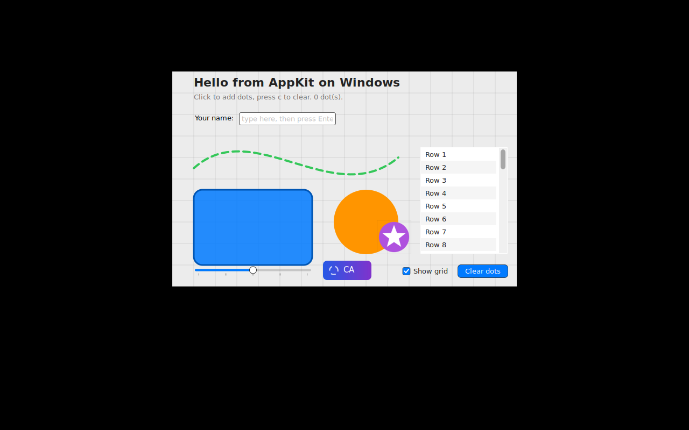

# AppKitWin

A source-compatible port of Apple's AppKit to Windows, written in Swift on top of
native Windows APIs (Win32, WinRT, DirectX 12, Direct2D, DirectWrite).

The long-term goal is a fully functioning SwiftUI stack on Windows. AppKit is the
first layer because SwiftUI on macOS is hosted by AppKit (`NSHostingView`,
`NSApplication`, the responder chain, `CALayer` trees). Linux is a planned
follow-on that reuses the platform-independent core with a different backend.

## Status

Pre-alpha. Milestone 1 ("open a window and draw into it") is in progress.
See [docs/ROADMAP.md](docs/ROADMAP.md) for milestones and
[docs/API-COVERAGE.md](docs/API-COVERAGE.md) for the generated coverage report.

## Layout

| Path | Purpose |
| --- | --- |
| `Sources/AppKit/Core` | Hand-written implementations of AppKit classes. |
| `Sources/AppKit/Generated` | Generated stubs for the public AppKit surface that compile today. Regenerate with `tools/apigen`. |
| `Sources/AppKit/Platform` | Backend protocols plus the Win32/DirectX backend and a headless host backend used for tests on macOS/Linux. |
| `Sources/CoreGraphics` | Windows implementation of the CoreGraphics drawing API over Direct2D (Windows only). |
| `Sources/CoreGraphics` (Windows only) | `CGContext`, `CGPath`, `CGColor` over Direct2D. |
| `Sources/Metal`, `Sources/MetalKit` | Metal's API as protocols with a CPU reference device and `MTKView`; D3D12 backend interface in `Sources/CMetalD3D12` (ADR-0004). |
| `Sources/AppKit/Platform/Linux`, `Sources/CCairo`, `Sources/CX11` | Linux backend: X11 windows, Cairo drawing, PangoCairo text (`tools/linux/Dockerfile` builds and screenshots it). |
| `Sources/QuartzCore` | `CALayer` tree, animations and transactions over `CGContext` (software compositor; shadows Apple's module inside the package on macOS so tests cover it). |
| `Sources/CD2D` (Windows only) | `extern "C"` shim over the Direct2D C++ interfaces, which have no C vtables. |
| `Stubs/Pending` | Generated stubs that do not compile yet. Not part of any target. |
| `api-inventory` | Condensed public API inventory extracted from the macOS SDK. Source of truth for stubs and coverage. |
| `tools/apigen` | Extraction, probing and stub generation scripts. |
| `Examples/HelloWindow` | Milestone 1 sample. |

## Building

On macOS (host build, used for type-checking the shared core and running tests
against the headless backend):

```bash
swift build && swift test
```

On Windows (requires the swift.org toolchain, 6.1 or newer, and the Windows 10 SDK):

```bash
swift build
swift run HelloWindow
```

## Regenerating the API inventory and stubs

```bash
tools/apigen/extract.sh      # macOS only: dumps symbol graphs from the SDK
tools/apigen/probe.sh        # macOS only: records enum raw values and string constants
python3 tools/apigen/apigen.py   # emits Generated/, Stubs/Pending/ and docs/API-COVERAGE.md
```

## Linux

`tools/linux/Dockerfile` builds the package on `swift:6.2-noble` with X11, Cairo and Pango, runs the test suite on the headless host backend and HelloWindow under Xvfb. The sample as rendered there (no window manager, so no decorations):


