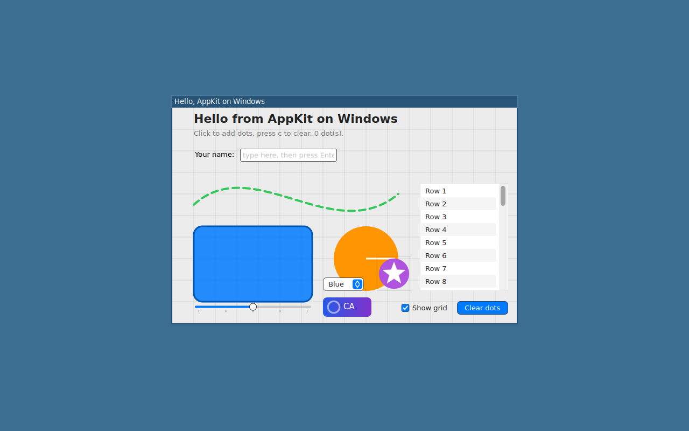
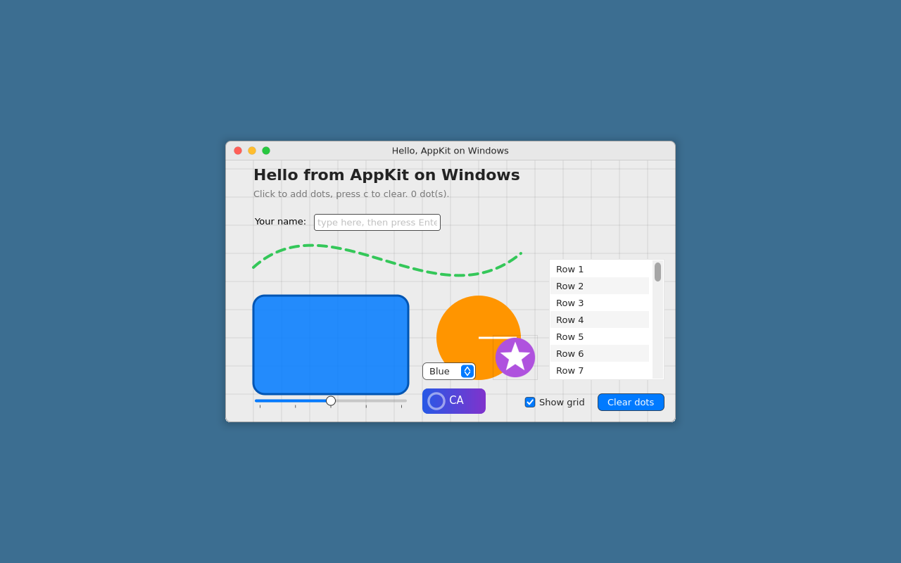

# Developing AppKitCross

Where things live, how the generated code is produced, and how each platform is built and
tested. The user-facing introduction is the [README](../README.md); the design is in
[ARCHITECTURE.md](ARCHITECTURE.md) and the [decision records](decisions/); the milestone
state is in [ROADMAP.md](ROADMAP.md).

## Layout

| Path | Purpose |
| --- | --- |
| `Sources/AppKit/Core` | Hand-written implementations of AppKit classes. |
| `Sources/AppKit/Generated` | Generated stubs for the public AppKit surface that compile today. Regenerate with `tools/apigen`. |
| `Sources/AppKit/Platform` | Backend protocols plus the Win32/DirectX backend, the Linux backend and a headless host backend used for tests on macOS/Linux. |
| `Sources/CoreGraphics` (Windows and Linux only) | `CGContext`, `CGPath`, `CGColor`, `CGImage` over Direct2D or Cairo. |
| `Sources/CoreText` (Windows and Linux only) | CoreText's API over DirectWrite or Pango/HarfBuzz (ADR-0007). |
| `Sources/QuartzCore` | `CALayer` tree, animations and transactions over `CGContext` (software compositor; shadows Apple's module inside the package on macOS so tests cover it). |
| `Sources/Metal`, `Sources/MetalKit` | Metal's API as protocols with a CPU reference device and `MTKView`; the Direct3D 12 backend in `Sources/CMetalD3D12` (ADR-0004) on Windows and the Vulkan backend in `Sources/CMetalVulkan` (ADR-0012) on Linux, each used unless `APPKITWIN_METAL_REFERENCE=1`. On Windows `MTKView` presents through a DXGI composition swap chain shown by the window's DirectComposition tree; on Linux through a `VkSwapchainKHR` on a child X window or a Wayland subsurface under the view (ADR-0012, ADR-0042); on the host backend (tests) frames are read back and drawn. |
| `Sources/Combine` (Windows and Linux only) | Apple's Combine API as a port of OpenCombine (ADR-0008); on macOS the package uses Apple's Combine. |
| `Sources/UniformTypeIdentifiers`, `Sources/ImageIO` (Windows and Linux only) | `UTType` over a table generated from the macOS SDK (`tools/uttypes`); `CGImageSource`/`CGImageDestination` over WIC or Cairo (ADR-0009). |
| `Sources/SwiftUI` | SwiftUI over this AppKit (ADR-0010): runtime, layout, views and modifiers; built on every platform. |
| `Sources/CD2D`, `Sources/CDirectWrite`, `Sources/CDirectComposition` (Windows only) | `extern "C"` shims over the Direct2D, DirectWrite and DirectComposition C++ interfaces, which have no C vtables. |
| `Sources/AppKit/Platform/Linux`, `Sources/CCairo`, `Sources/CX11`, `Sources/CWayland` | Linux backend: Wayland (xdg-shell) or X11 windows, Cairo drawing, PangoCairo text. |
| `Stubs/Pending` | Generated stubs that do not compile yet. Not part of any target. |
| `api-inventory` | Condensed public API inventory extracted from the macOS SDK. Source of truth for stubs and coverage. |
| `tools/apigen` | Extraction, probing and stub generation scripts. |
| `tools/linux` | Dockerfile, test and screenshot scripts for the Linux container. |
| `Sources/AVFAudio`, `Sources/AVFoundation` | The audio engine under Apple's module names (ADR-0014), with the WASAPI, PipeWire and ALSA shims in `Sources/CWASAPI`, `CPipeWire`, `CALSA`. |
| `Examples/HelloWindow` | The sample: AppKit drawing, controls, menus, a glass window, the Layout Demo and the SwiftUI demo. |
| `Examples/Calculator`, `FramelessWindow`, `Animation`, `Drawing`, `Observable`, `AudioPlayer`, `TextEdit`, `Toolbar`, `Glass`, `Sheets`, `Workspace` | Small, self-contained examples, one executable target each (see [Examples](#examples)). |
| `Examples/DailyTodo` | A real third-party SwiftUI app (Daily To Do, MIT) vendored unmodified, with shims for the Apple frameworks the port lacks; the gaps it found are in [compatibility/swiftui-apps.md](compatibility/swiftui-apps.md). |
| `Examples/MDVault` | A real document-based SwiftUI app (MD Vault, MIT) vendored with one `@MainActor`; its Info.plist and icon under `Resources/`, the target's SwiftPM bundle (ADR-0045); the gaps it found are in [compatibility/swiftui-apps.md](compatibility/swiftui-apps.md). |
| `Examples/LibraryCompat` | A package of its own: third-party SwiftUI libraries as dependencies, one tab each, with the per-library verdicts and API gaps in [compatibility/swiftui-libraries.md](compatibility/swiftui-libraries.md). Built by `tools/library-compat.sh` (see below). |

## Conventions

- Public API names, signatures and semantics match Apple's AppKit exactly. The inventory in
  `api-inventory/` is the source of truth; nothing is invented.
- `Sources/AppKit/Core` is hand-written and owns a class entirely. Once a type is listed in
  `tools/apigen/config.json` under `handwritten`, the generator stops emitting it. Seed a new
  hand-written type by moving its file from `Generated/` and regenerating (nested types move
  to `Generated/<Name>+Types.swift`).
- A nested type that Core declares (in the type's body or an extension of it, in any Core
  file) is never emitted in a `+Types` companion, and a hand-written type with all its nested
  types in Core has no companion at all (ADR-0037). To take over a nested type, declare it in
  Core and regenerate; no `skipMembers` entry or hand deletion is needed. A clean
  `python3 tools/apigen/apigen.py` on main leaves `git status` clean (`GeneratorDriftTests`
  checks the checked-in files).
- Everything else under `Sources/AppKit/Generated` is machine-generated. Fix
  `tools/apigen/apigen.py` and regenerate rather than editing those files.
- Unimplemented behaviour calls `unimplemented()`; stubs never return dummy values.
- Platform code lives behind the protocols in `Platform/Backend.swift`. AppKit core files
  never import `WinSDK` directly.
- The macOS host build exists for type-checking and tests. Windows-only modules are only
  declared in `Package.swift` when building on Windows; on macOS the core compiles against
  Apple's real CoreGraphics, CoreText, Combine and friends so signatures stay honest and the
  tests act as the specification.

## Building and testing

macOS (host build, headless backend):

```bash
swift build && swift test
```

Windows 11 (swift.org toolchain 6.2 or newer, Visual Studio Build Tools, Windows 10/11 SDK):

```bash
swift build
swift run HelloWindow
APPKITWIN_HOST_BACKEND=1 swift test
```

On Windows the test suite also runs the Direct3D 12 device (`MetalD3D12DeviceTests`,
`MetalD3D12ParityTests`): on a machine without a GPU, and on CI, that is WARP. HelloWindow's
Metal tab (`APPKITWIN_LAYOUT_TAB=metal`, or `--metal`) is where swap-chain presentation is
exercised; `--metal-log` prints the device, and every 30th frame's clear colour, read-back
pixels, drawable size and presentation path (`swap chain` on a DirectComposition-hosted
window, `readback` otherwise).

If a Windows build of AppKit ends with exit code 1 and no `error:` right after its last
`Compiling AppKit …` line, build with `-j 1` (CI always does).
Swift 6.2's driver sometimes never starts AppKit's emit-module job and says nothing
(`docs/ci-windows-runner.md`). `tools/windows/frontend-monitor.ps1` records every compiler
process's exit code and peak memory when a build dies quietly again.

Linux, in the container from `tools/linux/Dockerfile` (`swift:6.2-noble` with X11, Wayland,
Cairo and Pango):

```bash
docker build -t appkitwin-linux -f tools/linux/Dockerfile .
docker run --rm -v "$PWD":/src -w /src appkitwin-linux bash -c "swift build; APPKITWIN_HOST_BACKEND=1 swift test"
docker run --rm -v "$PWD":/src -w /src appkitwin-linux bash tools/linux/run.sh            # host tests, then the X11 backend tests (XDND, clipboard), HelloWindow and the examples under Xvfb
docker run --rm -v "$PWD":/src -w /src appkitwin-linux bash tools/linux/run.sh --wayland  # the same under a headless sway
```

### The library compatibility example

`Examples/LibraryCompat` is a separate SwiftPM package (so the core package has no
dependencies) that pulls in third-party SwiftUI libraries and builds them against this
`SwiftUI`. Those packages do not declare a dependency on AppKitCross, so its modules must be in
the build's `Modules` directory before they compile, and a client of `AppKit` needs the C
shim module maps (`CCairo`, `CD2D`, …) that SwiftPM only passes to declared dependents;
`tools/library-compat.sh` does both, on every platform:

```bash
tools/library-compat.sh            # build the example (step 1: SwiftUI, step 2: the libraries and the app)
tools/library-compat.sh --probe    # also build each library on its own and print its first error
tools/library-compat.sh --run      # build, then run it
Examples/LibraryCompat/.build/debug/LibraryCompat --screenshot /tmp/shots   # one PNG per tab, then exit
```

On macOS the script raises every target's deployment target to 14.0 (the libraries declare
10.15–12 and the host build's modules 14), which is what lets the host build type-check the
libraries against this SwiftUI rather than Apple's. Which libraries are linked into the app
on each platform is decided in `Examples/LibraryCompat/Package.swift`; a library that does
not compile stays declared there so the probe can re-check it.

The container has no GPU: Mesa's lavapipe (`mesa-vulkan-drivers`) is the Vulkan device the
Metal module runs on there, so the Metal tests and `HelloWindow --metal-selftest` exercise the
Vulkan backend (ADR-0012), and `tools/linux/run.sh` (`--wayland`) also captures HelloWindow's Metal
tab on each window backend. Without a Vulkan loader or ICD the Metal module falls back to the
reference device and the suite still passes; without `libvulkan-dev` the shim builds as stubs.
HLSL and MSL shaders are compiled to SPIR-V with `glslangValidator` (`glslang-tools`) or `dxc`
from `PATH`; SPIR-V can also be passed through `makeLibrary(data:)`.

Two Linux window backends share the Cairo drawing, PangoCairo text and the rest of the
platform code: Wayland (xdg-shell toplevels with wl_shm buffers, xkbcommon keyboards,
wl_cursor themes, server-side decorations through xdg-decoration) is preferred when
`WAYLAND_DISPLAY` is set and the connection succeeds, X11 is the fallback;
`APPKITWIN_LINUX_BACKEND=x11|wayland` forces one. Under sway the compositor draws the title
bar (server-side decorations through xdg-decoration); where the compositor offers none
(GNOME's Mutter) or answers client side, the package draws the frame itself: title band
with the standard buttons, shadow, rounded corners, move and resize through the compositor
(ADR-0015). `APPKITWIN_WAYLAND_DECORATIONS=client` forces that under sway:

| sway's frame (server side) | the package's frame (client side) |
|---|---|
|  |  |

## Shipping an app

ADR-0046. Your app is a SwiftPM package that depends on AppKitCross
(`Examples/Dependent` is the smallest one). It builds with a plain `swift build` on all
three platforms; on macOS either set `platforms: [.macOS(.v14)]` or, better, depend on the
port only off macOS so the Mac build uses Apple's frameworks:

```swift
let port: [Platform] = [.windows, .linux]
.executableTarget(name: "MyApp", dependencies: [
    .product(name: "AppKit", package: "AppKitCross", condition: .when(platforms: port)),
    .product(name: "SwiftUI", package: "AppKitCross", condition: .when(platforms: port)),
])
```

On Windows with Swift 6.2, pass `-j 1` to `swift build`, `swift test` and `swift package`
(the driver bug in docs/ci-windows-runner.md); that is a toolchain workaround no manifest
can set. Nothing else from `tools/library-compat.sh` applies to a package that declares
the dependency: module order and the C shims' module maps come with it.

### The app folder

```bash
swift package --allow-writing-to-package-directory bundle --product MyApp -c release --zip
#   Windows (Swift 6.2): swift package -j 1 --allow-writing-to-package-directory bundle ...
```

builds `MyApp` in release (the default; `-c debug` for a debug folder) and writes
`.build/bundle/MyApp/`, a folder that runs on a machine without Swift, and with `--zip`
`.build/bundle/MyApp-<version>-<windows|linux>-<x86_64|arm64>.zip`. Copy the folder (or
unzip it) anywhere and run `MyApp.exe` / `./MyApp`. It contains, side by side:

- the executable;
- every shared library it loads that the target machine does not have: on Windows the Swift
  runtime DLLs (`swiftCore`, `swift_Concurrency`, `Foundation`, `FoundationEssentials`,
  `_FoundationICU`, `dispatch`, `BlocksRuntime`, …) and the Visual C++ runtime
  (`vcruntime140*.dll`, `msvcp140*.dll`; the Universal CRT ships with Windows 10+); on Linux
  the Swift runtime `.so` files plus Cairo, Pango, GLib and their dependencies, leaving
  glibc, libstdc++, X11/xcb, Wayland, xkbcommon, fontconfig/FreeType/HarfBuzz, D-Bus,
  PipeWire and the GPU stack to the system (install `patchelf` so the copied libraries find
  each other; the tool says when it is missing);
- the SwiftPM resource bundles of the product's targets (`MyPkg_MyApp.resources`);
- `Info.plist`, `Resources/` and `*.ico`/`*.png` from the nearest directory, from the
  executable target's directory up to (not including) the package root, with an
  application `Info.plist` or `<exe>-Info.plist` (in `Resources/` or the directory, the
  names ADR-0045 reads) or a `Resources/`; a resource bundle's
  plist (`CFBundlePackageType` BNDL, an identifier ending in `.resources`) is skipped. The
  package root is searched only for a target whose sources live there, except that a root
  holding the app's own `Resources/Info.plist`, `Resources/<exe>-Info.plist` or
  `<exe>-Info.plist` gives that plist (and its version), that `Resources/` and the icons
  beside the plist when nothing nearer does (a bare root `Info.plist` never counts);
  otherwise name the plist with `--info-plist` (`--resources`, `--icon` override the
  rest). The bundle
  identity layout (ADR-0045) defines how the app reads them;
- on Windows, `<Name>.pdb`: a release build through the plugin adds `-g
  -debug-info-format=codeview` and `-Xlinker -debug` so the linker writes one, and crash
  reports name functions with it (`--no-debug-info` leaves it out; building yourself, pass
  `-Xswiftc -g -Xswiftc -debug-info-format=codeview -Xlinker -debug`).

Other options: `--output <dir>`, `--version <v>` (else `CFBundleShortVersionString`, else
0.0.0), `--appimage` (Linux; needs `appimagetool` on PATH, otherwise skipped with a
message), `--no-build` (bundle what the last build produced). The run prints what it
bundled, what it left to the system and any library it could not find (exit status 2 and a
warning: that folder will not start elsewhere). The tool behind the plugin is
`AppKitCrossBundle`, which can also be run directly on an executable you built yourself.

The Linux folder runs on distributions at least as new as the build machine's (glibc and
libstdc++ come from the system): build on the oldest one you support. On macOS the folder
is only a layout check; ship a Mac app with Xcode.

### Crash reports

`NSApplication` installs a crash handler at launch on Windows and Linux. A crash leaves:

- Windows: `%LOCALAPPDATA%\<bundle id>\Crashes\<app>-<time>-<pid>.dmp` (a minidump; open it
  in Visual Studio or WinDbg with the build's PDB, so keep the PDB of every release) and
  `.txt` (exception, module and offset, thread, a stack with function names where the PDB
  is beside the executable, module offsets only without it);
- Linux: `~/.local/share/<bundle id>/Crashes/<app>-<time>-<pid>.txt` (`$XDG_DATA_HOME` when
  set): signal, fault address, thread, the backtrace as module+offset (`addr2line -e
  <module> <offset>`, `swift demangle` for the names) and the memory map.

The `Crashes` directory is created with the first report, not at launch. The bundle id is
the Info.plist's `CFBundleIdentifier`, else the executable's name. The
process still ends with the crash's own status (and Windows Error Reporting or a core dump
as usual). `APPKITWIN_CRASH_REPORTER=0` turns the handler off, `APPKITWIN_CRASH_DIR=<dir>`
moves the reports, `APPKITWIN_CRASH_TEST=1` (or `trap`, `abort`) crashes the app on purpose
a second after launch to check the whole path.

## Examples

Each example under `Examples/` is an executable target in `Package.swift` with a README that
says what it demonstrates. CI builds every one on macOS, Windows and both Linux jobs, and
`tools/linux/run.sh` runs each under Xvfb and writes `/tmp/<name>-linux.png` (plus
`Drawing --export`, the headless PNG path).

| Example | Shows | Run |
| --- | --- | --- |
| `HelloWindow` | The big tour: drawing, controls, menus, the glass window, the Layout Demo and the SwiftUI demo; a localized line and an image from its SwiftPM bundle (ADR-0045) | `swift run HelloWindow` (`--swiftui`, `--layout`, `--metal`, `--screenshot <dir>`, `--metal-selftest`, `--bundle-report`, `-AppleLanguages "(de)"`) |
| `Calculator` | SwiftUI `App` + `WindowGroup`, button grid, `keyboardShortcut` keys, fixed-size window, `CommandMenu` | `swift run Calculator` |
| `FramelessWindow` | `.fullSizeContentView` window with AppKit's window buttons, rounded non-opaque shape, movable by background, `NSVisualEffectView` backdrop, close/minimize/zoom, a `.borderless` panel | `swift run FramelessWindow` (`--panel`) |
| `Animation` | `CABasicAnimation`, `CAKeyframeAnimation` along a path, 3D flip with perspective, `CAAnimationGroup`, implicit `CATransaction` animations, play/pause, SwiftUI `withAnimation` | `swift run Animation` (`--paused`) |
| `Drawing` | `draw(_:)` with paths, gradient, text, images; sketch canvas with mouse tracking, undo/redo, PNG export through `NSSavePanel` | `swift run Drawing` (`--export file.png`) |
| `Observable` | `ObservableObject`/`@Published` model, live `List`, detail pane over a `Binding`, Combine `Timer.publish` | `swift run Observable` |
| `TextEdit` | `NSDocument`/`NSDocumentController` document app: types from `Info.plist`, plain text and RTF, File menu with Open Recent, unsaved-changes alerts, edited dot, the file panels | `swift run TextEdit` (`file.txt`, `--roundtrip out.rtf`, `--show-save-panel`) |
| `Sheets` | Attached sheets (ADR-0019): `NSAlert`/`NSOpenPanel` sheets, a custom `beginSheet` window with a nested sheet, `runModal(for:)` over a sheet, queued sheets, SwiftUI `.sheet` and `.confirmationDialog` | `swift run Sheets` (`--alert`, `--custom`, `--swiftui-sheet`) |
| `AudioPlayer` | `AVAudioEngine`, two `AVAudioPlayerNode`s (file, generated sine), play/pause/loop, `installTap` level meter, output device and latency, offline render through `AVAudioFile` | `swift run AudioPlayer` (`file.wav`, `--render out.wav`) |
| `Toolbar` | `NSToolbar` (image items, `NSToolbarItemGroup`, `NSMenuToolbarItem`, `NSSearchToolbarItem`, validation, overflow, the customization sheet, autosave) and an `NSStatusItem` with a menu | `swift run Toolbar` |
| `Glass` | Liquid Glass (ADR-0052): the toolbar band and item capsules on the material over scrolling content, `NSGlassEffectContainerView` merging two glass buttons, clear and tinted `NSGlassEffectView`s, SwiftUI `GlassEffectContainer`, `.glass`/`.glassProminent` buttons, an interactive `glassEffect` | `APPKITWIN_LIQUID_GLASS=1 swift run Glass` |
| `Workspace` | `NSWorkspace` (open a URL, reveal in the file manager, icons, recycle, `urlForApplication`), `NSRunningApplication` (frontmost, launch, activate, hide, terminate) and `NSDockTile` (a badge on the taskbar button) | `swift run Workspace` (`--report`) |
| `DailyTodo` | Daily To Do, a real third-party SwiftUI app vendored unmodified: `NavigationStack` + toolbar, `DatePicker`s, a checkbox `List`, `ContentUnavailableView`, a `.sheet` with a grouped `Form`, `LabeledContent`, `Picker`, `environmentObject`, JSON persistence; `UserNotifications`/`ServiceManagement` shims off macOS; its self-checks as `DailyTodoChecks` | `swift run DailyTodo`, `swift run DailyTodoChecks` |
| `MDVault` | MD Vault, a real document-based SwiftUI app: `DocumentGroup` + `FileDocument`, an `NSTextView` representable editor, a SwiftUI Markdown viewer, `@FocusedValue` commands, `@AppStorage`; its icon, the `.md` association (`--appkitcross-register`) and the single instance (ADR-0045) | `swift run MDVault` (`file.md`) |

The port has no Observation framework (`@Observable`), so Observable uses `ObservableObject`;
`UndoManager` and `FileWrapper` are missing from swift-corelibs-foundation and the port supplies
them in `Sources/AppKit/Support` on Windows and Linux (Drawing predates that and keeps its own
undo stacks).

## App layout on Windows and Linux

A Mac app's `Bundle.main`, `NSLocalizedString`, `NSImage(named:)`, Info.plist and icon code runs
unchanged when the app's files sit in this layout ([ADR-0045](decisions/ADR-0045-app-bundle.md)).
It is what `swift build` already produces, plus an Info.plist; the app-folder layout tool copies
the same shape:

```
MyApp/
  MyApp.exe            (MyApp on Linux)
  Info.plist           or Resources/Info.plist, or in the executable's SwiftPM bundle
                       (Resources/Info.plist or MyApp-Info.plist: SwiftPM refuses a resource
                       named Info.plist at the top)
  Resources/           optional, what Contents/Resources holds on macOS
  MyPkg_MyApp.resources/   SwiftPM's bundle of the executable target, e.g. its
                       `.copy("Resources")` folder: en.lproj/, de.lproj/, Assets.xcassets/,
                       AppIcon.png, sounds
  MyPkg_OtherModule.resources/   Bundle.module of the app's other targets
  runtime DLLs / .so
```

- `Bundle.main` searches `Resources/`, then the executable target's bundle (its `Resources/`
  folder first), then the executable's folder. `APPKITWIN_INFO_PLIST` names an Info.plist
  anywhere, for a bare `swift run`.
- Strings: `<lang>.lproj/Localizable.strings` and `.stringsdict`, or a String Catalog
  (`Localizable.xcstrings`, uncompiled) at a resource root. The language comes from the user's
  UI languages on Windows, from `LANGUAGE`, `LC_ALL`, `LC_MESSAGES` and `LANG` on Linux, or from
  `-AppleLanguages "(de)"` on the command line to try one: `swift run HelloWindow -AppleLanguages "(de)"`.
- Asset catalogs are read uncompiled. Copy the `.xcassets` folder as a resource. Image sets,
  app icon sets, data sets and colour sets are read; dark variants are skipped.
- The icon is the Info.plist's `CFBundleIconName` (an app icon set) or `CFBundleIconFile`
  (`AppIcon` finds `AppIcon.png`, then `AppIcon.ico`; `.icns` is not read). It goes on the
  windows' title bar, the taskbar and Alt-Tab (Windows), and on `_NET_WM_ICON` (X11). On
  Wayland the compositor takes the icon from the desktop entry named after the identity.
- The identity is `CFBundleIdentifier`, else `AppKitCross.<exe>`. It is the Wayland app id, the
  X11 `WM_CLASS`, the desktop entry id and the single-instance key.
- With a `CFBundleIdentifier`, a second launch hands its arguments to the running instance and
  exits. Turn that off with `AppKitCrossAllowsMultipleInstances` = YES in the Info.plist or
  `APPKITWIN_MULTIPLE_INSTANCES=1`.
- File associations and URL schemes (`CFBundleDocumentTypes`, `CFBundleURLTypes`) are
  registered per user only when asked. `MyApp --appkitcross-register` writes HKCU
  `Software\Classes` (ProgIDs, OpenWithProgids, Capabilities for Settings > Default apps), or
  `~/.local/share/applications/<id>.desktop` with MIME types and the icon.
  `--appkitcross-unregister` removes them. Info.plist `AppKitCrossRegistersFileTypes` = YES
  registers at launch when the registration is missing.
- Documents and URLs on the command line (`MyApp file.md`, `MyApp myscheme://x`) reach
  `NSDocumentController` or `application(_:openFile(s):)`/`application(_:open:)`. Explorer and
  the desktop launch apps this way.

## Threading

`NSApplication`, `NSWindow`, `NSView` and the other main-actor types are `@MainActor`, as in
Apple's SDK; `NSImage`, `NSColor`, `NSFont`, `NSBezierPath` and the text storage classes are
not. On Windows and Linux the backend owns the event loop: each pump waits on the main
dispatch queue's wake handle with its window events and drains the queue through
libdispatch's run-loop hook (`Platform/MainQueue.swift`), and steps the main `RunLoop` for
its timers, so `DispatchQueue.main.async`, hops to `@MainActor` from other threads and
`Timer` behave as on macOS. The headless host backend runs the main run loop directly.

## Runtime switches

| Variable | Effect |
| --- | --- |
| `APPKITWIN_SOFTWARE_LAYERS=1` | Software compositing instead of DirectComposition on Windows. |
| `APPKITWIN_LEGACY_TEXT=1` | The pre-CoreText text path on Windows. |
| `APPKITWIN_METAL_REFERENCE=1` | The CPU Metal device instead of Direct3D 12 (Windows) or Vulkan (Linux). |
| `APPKITWIN_LIQUID_GLASS=1` | macOS 26's Liquid Glass (ADR-0052): the toolbar band and items, the sidebar column, `NSGlassEffectView`, within-window `NSVisualEffectView`, SwiftUI `glassEffect` and the `.glass`/`.glassProminent` button styles draw the material over the content beneath: the backdrop blurred and saturated, bent into the rim of a lens with its highlight and sheen, veiled light or dark by the backdrop's luminance; the toolbar band mirrors the document below it into its material. The `AppKitCrossLiquidGlass` Info.plist key (Boolean) does the same for a shipped app. Off (the default), every surface draws as it did before the switch existed. |
| `APPKITWIN_VULKAN_DEBUG=1` | Enables `VK_LAYER_KHRONOS_validation` on the Vulkan device when installed, with its messages on stderr. |
| `APPKITWIN_VULKAN_DEVICE=n` | Picks Vulkan physical device `n` instead of the best one. |
| `APPKITWIN_DXGI_DEBUG=1` | Reports live DXGI objects at exit. |
| `APPKITWIN_LINUX_BACKEND=x11\|wayland` | Forces a Linux window backend. |
| `APPKITWIN_WAYLAND_DECORATIONS=client\|server` | What Wayland windows ask xdg-decoration for (the compositor has the last word); `client` shows the package's own frame on a compositor that would draw one (ADR-0015). |
| `APPKITWIN_DEMO_TAB=data` | Opens the HelloWindow SwiftUI demo on that tab (controls, navigation, presentation, data); screenshots are named by tab. |
| `APPKITWIN_LAYOUT_TAB=table` | Opens the HelloWindow Layout Demo on that tab (form, split, table, metal, combo, outline, controls, date, diffable, panels, popover); screenshots are named by tab. |
| `APPKITWIN_PANELS_OPEN=color\|font` | With the Layout Demo's Panels tab, opens the Colors or Fonts panel at launch (screenshots `color-panel`, `font-panel`). |
| `APPKITWIN_COLOR_PANEL=native` | `NSColorPanel.orderFront` runs the system colour dialog (Windows' ChooseColor) instead of the package-drawn panel (ADR-0031); ignored where there is none. |
| `APPKITWIN_COMPAT_TAB=confetti` | Opens `LibraryCompat` on that library's tab (shimmer, confetti, wrapping, defaults, markdown, introspect, charts, nuke). |
| `APPKITWIN_CRASH_REPORTER=0` | Does not install the crash handler (ADR-0046) at launch. |
| `APPKITWIN_CRASH_DIR=<dir>` | Writes crash reports there instead of `%LOCALAPPDATA%\<bundle id>\Crashes` / `~/.local/share/<bundle id>/Crashes`. |
| `APPKITWIN_CRASH_TEST=1\|trap\|abort` | Crashes the app on purpose a second after launch (a null write, a trap as fatalError executes, `abort()`) to check the crash report path. |
| `APPKITWIN_INFO_PLIST=path` | The Info.plist to use for a bare executable (`swift run`), ahead of the app folder's (ADR-0045). |
| `APPKITWIN_MULTIPLE_INSTANCES=1` | No single-instance hand-off: every launch runs its own process (ADR-0045). |
| `APPKITWIN_CORELIBS_BUNDLE=1` | Leaves swift-corelibs-foundation's `Bundle` alone (no vtable hooks): `Bundle.main` is the executable's folder only and `NSLocalizedString` answers in the development language (ADR-0045). |
| `-AppleLanguages "(de, en)"` (argument) | The preferred languages for this run, as on macOS (ADR-0045). |
| `APPKITWIN_HOST_BACKEND=1` | The headless backend the tests use; the suite expects it on Windows and Linux. Unset it before running an example: with it set no native window is created (the package says so on stderr). |
| `APPKITWIN_PRINT_PANEL=native` | The platform's own print dialog (`PrintDlgEx` on Windows) instead of the package's print panel; Linux has none, so the package's panel shows either way (ADR-0022). |
| `APPKITWIN_IME_LAYOUT=00000411` | Windows: activates that keyboard layout for the process and opens its IME in native mode on focus (00000411 is Japanese), for testing composition without changing the system's input settings. |
| `APPKITWIN_TRACE_TEXTINPUT=1` | Logs input method steps on stderr as `[textinput] ...` (ADR-0047): context activation, `setMarkedText`/`insertText`/cancel with their text, the TSF store's edits, focus, `GetTextExt` rectangles and candidate counts (Windows), IMM composition strings, text-input-v3 batches (Wayland) and XIM preedit draws and commits (X11). |
| `APPKITWIN_TSF=0` | Windows: no Text Services Framework; input methods compose through IMM32 (`WM_IME_*`) instead. `APPKITWIN_TSF_KEYS=0` keeps TSF but stops offering key messages to it before `TranslateMessage` (its own keyboard hook still runs). |
| `APPKITWIN_XIM=0` | X11: no input method (XIM) at all; keys are looked up without an input context. |
| (gestures) | No switch: on Windows, Ctrl+wheel is delivered as a magnify gesture (a precision touchpad's pinch arrives that way) and touch screens send WM_GESTURE; on X11 gestures need XInput 2.4 (libinput); on Wayland the compositor must offer `zwp_pointer_gestures_v1`. |
| `APPKITWIN_LAYOUT_DIRECTION=rtl\|ltr` | Forces the application's layout direction; otherwise the macOS defaults keys (`AppleTextDirection`, `NSForceRightToLeftWritingDirection`) and then the locale's language decide. |
| `APPKITWIN_TRACE=1` | Logs every view invalidation, SwiftUI node update, root layout pass and ideal-size change (for repaint loops). |
| `APPKITWIN_TRACE_FRAMES=1` | Logs what each frame costs, in ms: every constraint solve (`frames solve <root> N constraints`, with the gather and the intrinsic-size share and the text-measure cache hits), each window's layout and draw (`frames paint`), and how late each frame tick ran (`frames tick`). For a held stepper or an animation that stutters on one platform. |
| `APPKITWIN_STEPPER_PROBE=1` | With `APPKITWIN_LAYOUT_TAB=controls`: prints the stepper's upper half in screen pixels (`stepper at X Y`) a second after the window is up, then each step of a hold with its offset since the first (`stepper value 5 +0.512s`). `APPKITWIN_STEPPER_HOLD=<seconds>` makes the demo hold its own stepper for that long (through the window's event path), lay out after each step, print `stepper hold done` and quit, so the offsets and the frame trace come from a script, no mouse needed. |

## Audio backends and the offline render switch

`Sources/AVFAudio` (ADR-0014) is the audio engine, built on Windows and Linux; on macOS the
package uses Apple's AVFAudio so `NSSound`, the AudioPlayer example and `AudioTests` are
checked against the real API. `APPKITWIN_HOST_AVFAUDIO=1 swift test --filter AudioTests`
builds ours on the Mac as well (shadowing Apple's inside the package) and runs the engine
tests against it; the macOS CI job does both.

The engine talks to the device through `PlatformAudio` (`Sources/AVFAudio/Platform`):

| Backend | Platform | Shim | Notes |
| --- | --- | --- | --- |
| WASAPI | Windows | `Sources/CWASAPI` (C++ over COM) | Shared mode, event driven; `IAudioClient3` low-latency period when the driver offers one, `IAudioClient` default period otherwise; render thread on the "Pro Audio" MMCSS task; the device's mix format and rate. |
| PipeWire | Linux | `Sources/CPipeWire` (dlopen) | Needs `libpipewire-0.3-dev` at build time (the `CPipeWireSystem` target supplies the include paths); without the headers the shim is a stub. `pw_stream` with `RT_PROCESS`; PipeWire resamples to the graph rate. |
| ALSA | Linux | `Sources/CALSA` (dlopen) | Fallback when PipeWire is absent at runtime; `default` PCM, 10 ms periods, blocking writes. Needs `libasound2-dev` at build time. |
| Null | all | none | A timer thread rendering into a scratch buffer: the engine runs with no device (CI, the container, tests). |

`APPKITWIN_AUDIO_BACKEND=wasapi|pipewire|alsa|null` picks one; otherwise the platform's
native backend, falling through PipeWire to ALSA on Linux. `AVAudioEngine.start()` throws
when no device stream opens, and `APPKITWIN_AUDIO_LOG=1` prints why a Linux backend was
skipped. The engine logs nothing itself; `AVAudioEngine._outputDescription` (port only)
names the backend, device, rate, period and latency, and the AudioPlayer example shows it
in its status line.

Machines without a sound device (CI runners, the Linux container) verify the engine
through `AVAudioEngine`'s manual rendering mode: `swift run AudioPlayer --render out.wav`
renders two seconds of the example's mix through `AVAudioFile` and exits, which every CI
job and `tools/linux/run.sh` do, and `AudioTests` render offline and compare sample for
sample. Real playback is checked on the Windows machine (device name, latency, pause and
loop, a window drag without glitches) and recorded in the pull request.

## Regenerating the API inventory and stubs

```bash
tools/apigen/extract.sh          # macOS only: dumps symbol graphs from the SDK
tools/apigen/probe.sh            # macOS only: records enum raw values and string constants
python3 tools/apigen/apigen.py   # emits Generated/, Stubs/Pending/ and docs/API-COVERAGE.md
```

The symbol graphs in `api-inventory/raw/` are git-ignored; in a worktree copy them from the
main checkout (`cp -R ../../../api-inventory/raw api-inventory/raw`) before regenerating.

## Rendering comparisons

[comparisons.md](comparisons.md) shows the same windows on each platform. Regenerate the
macOS column headless and the Linux column under Xvfb:

```bash
swift run HelloWindow --swiftui --layout --screenshot docs/images/compare
docker run --rm -v "$PWD":/src -w /src appkitwin-linux bash tools/linux/compare.sh
```

The Windows column is captured from the live app on the Windows test machine.
