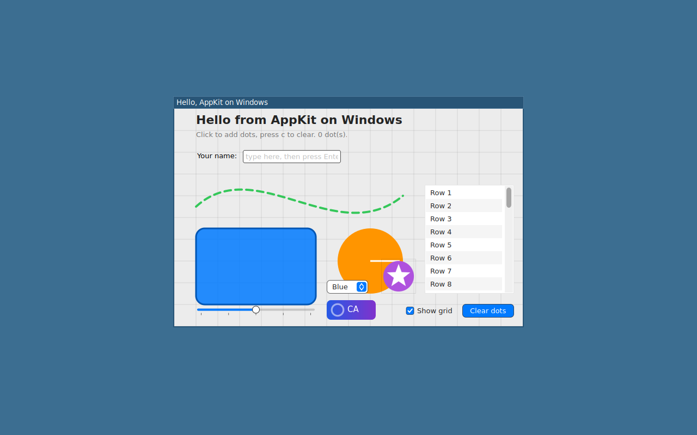

# Developing AppKitWin

Where things live, how the generated code is produced, and how each platform is built and
tested. The user-facing introduction is the [README](../README.md); the design is in
[ARCHITECTURE.md](ARCHITECTURE.md) and the [decision records](decisions/); the milestone
state is in [ROADMAP.md](ROADMAP.md).

## Layout

| Path | Purpose |
| --- | --- |
| `Sources/AppKit/Core` | Hand-written implementations of AppKit classes. |
| `Sources/AppKit/Generated` | Generated stubs for the public AppKit surface that compile today. Regenerate with `tools/apigen`. |
| `Sources/AppKit/Platform` | Backend protocols plus the Win32/DirectX backend, the Linux backend and a headless host backend used for tests on macOS/Linux. |
| `Sources/CoreGraphics` (Windows and Linux only) | `CGContext`, `CGPath`, `CGColor`, `CGImage` over Direct2D or Cairo. |
| `Sources/CoreText` (Windows and Linux only) | CoreText's API over DirectWrite or Pango/HarfBuzz (ADR-0007). |
| `Sources/QuartzCore` | `CALayer` tree, animations and transactions over `CGContext` (software compositor; shadows Apple's module inside the package on macOS so tests cover it). |
| `Sources/Metal`, `Sources/MetalKit` | Metal's API as protocols with a CPU reference device and `MTKView`; the Direct3D 12 backend in `Sources/CMetalD3D12` (ADR-0004) on Windows and the Vulkan backend in `Sources/CMetalVulkan` (ADR-0012) on Linux, each used unless `APPKITWIN_METAL_REFERENCE=1`. |
| `Sources/Combine` (Windows and Linux only) | Apple's Combine API as a port of OpenCombine (ADR-0008); on macOS the package uses Apple's Combine. |
| `Sources/UniformTypeIdentifiers`, `Sources/ImageIO` (Windows and Linux only) | `UTType` over a table generated from the macOS SDK (`tools/uttypes`); `CGImageSource`/`CGImageDestination` over WIC or Cairo (ADR-0009). |
| `Sources/SwiftUI` | SwiftUI over this AppKit (ADR-0010): runtime, layout, views and modifiers; built on every platform. |
| `Sources/CD2D`, `Sources/CDirectWrite`, `Sources/CDirectComposition` (Windows only) | `extern "C"` shims over the Direct2D, DirectWrite and DirectComposition C++ interfaces, which have no C vtables. |
| `Sources/AppKit/Platform/Linux`, `Sources/CCairo`, `Sources/CX11`, `Sources/CWayland` | Linux backend: Wayland (xdg-shell) or X11 windows, Cairo drawing, PangoCairo text. |
| `Stubs/Pending` | Generated stubs that do not compile yet. Not part of any target. |
| `api-inventory` | Condensed public API inventory extracted from the macOS SDK. Source of truth for stubs and coverage. |
| `tools/apigen` | Extraction, probing and stub generation scripts. |
| `tools/linux` | Dockerfile, test and screenshot scripts for the Linux container. |
| `Examples/HelloWindow` | The sample: AppKit drawing, controls, menus, a glass window, the Layout Demo and the SwiftUI demo. |

## Conventions

- Public API names, signatures and semantics match Apple's AppKit exactly. The inventory in
  `api-inventory/` is the source of truth; nothing is invented.
- `Sources/AppKit/Core` is hand-written and owns a class entirely. Once a type is listed in
  `tools/apigen/config.json` under `handwritten`, the generator stops emitting it. Seed a new
  hand-written type by moving its file from `Generated/` and regenerating (nested types move
  to `Generated/<Name>+Types.swift`).
- Everything else under `Sources/AppKit/Generated` is machine-generated. Fix
  `tools/apigen/apigen.py` and regenerate rather than editing those files.
- Unimplemented behaviour calls `unimplemented()`; stubs never return dummy values.
- Platform code lives behind the protocols in `Platform/Backend.swift`. AppKit core files
  never import `WinSDK` directly.
- The macOS host build exists for type-checking and tests. Windows-only modules are only
  declared in `Package.swift` when building on Windows; on macOS the core compiles against
  Apple's real CoreGraphics, CoreText, Combine and friends so signatures stay honest and the
  tests act as the specification.

## Building and testing

macOS (host build, headless backend):

```bash
swift build && swift test
```

Windows 11 (swift.org toolchain 6.2 or newer, Visual Studio Build Tools, Windows 10/11 SDK):

```bash
swift build
swift run HelloWindow
APPKITWIN_HOST_BACKEND=1 swift test
```

Linux, in the container from `tools/linux/Dockerfile` (`swift:6.2-noble` with X11, Wayland,
Cairo and Pango):

```bash
docker build -t appkitwin-linux -f tools/linux/Dockerfile .
docker run --rm -v "$PWD":/src -w /src appkitwin-linux bash -c "swift build; APPKITWIN_HOST_BACKEND=1 swift test"
docker run --rm -v "$PWD":/src -w /src appkitwin-linux bash tools/linux/run.sh            # HelloWindow under Xvfb, screenshots
docker run --rm -v "$PWD":/src -w /src appkitwin-linux bash tools/linux/run.sh --wayland  # the same under a headless sway
```

The container has no GPU: Mesa's lavapipe (`mesa-vulkan-drivers`) is the Vulkan device the
Metal module runs on there, so the Metal tests and `HelloWindow --metal-selftest` exercise the
Vulkan backend (ADR-0012). Without a Vulkan loader or ICD the Metal module falls back to the
reference device and the suite still passes; without `libvulkan-dev` the shim builds as stubs.
HLSL and MSL shaders are compiled to SPIR-V with `glslangValidator` (`glslang-tools`) or `dxc`
from `PATH`; SPIR-V can also be passed through `makeLibrary(data:)`.

Two Linux window backends share the Cairo drawing, PangoCairo text and the rest of the
platform code: Wayland (xdg-shell toplevels with wl_shm buffers, xkbcommon keyboards,
wl_cursor themes, server-side decorations through xdg-decoration) is preferred when
`WAYLAND_DISPLAY` is set and the connection succeeds, X11 is the fallback;
`APPKITWIN_LINUX_BACKEND=x11|wayland` forces one. Under sway the compositor draws the title
bar:



## Threading

`NSApplication`, `NSWindow`, `NSView` and the other main-actor types are `@MainActor`, as in
Apple's SDK; `NSImage`, `NSColor`, `NSFont`, `NSBezierPath` and the text storage classes are
not. On Windows and Linux the backend owns the event loop: each pump waits on the main
dispatch queue's wake handle with its window events and drains the queue through
libdispatch's run-loop hook (`Platform/MainQueue.swift`), and steps the main `RunLoop` for
its timers, so `DispatchQueue.main.async`, hops to `@MainActor` from other threads and
`Timer` behave as on macOS. The headless host backend runs the main run loop directly.

## Runtime switches

| Variable | Effect |
| --- | --- |
| `APPKITWIN_SOFTWARE_LAYERS=1` | Software compositing instead of DirectComposition on Windows. |
| `APPKITWIN_LEGACY_TEXT=1` | The pre-CoreText text path on Windows. |
| `APPKITWIN_METAL_REFERENCE=1` | The CPU Metal device instead of Direct3D 12 (Windows) or Vulkan (Linux). |
| `APPKITWIN_VULKAN_DEBUG=1` | Enables `VK_LAYER_KHRONOS_validation` on the Vulkan device when installed, with its messages on stderr. |
| `APPKITWIN_VULKAN_DEVICE=n` | Picks Vulkan physical device `n` instead of the best one. |
| `APPKITWIN_DXGI_DEBUG=1` | Reports live DXGI objects at exit. |
| `APPKITWIN_LINUX_BACKEND=x11\|wayland` | Forces a Linux window backend. |
| `APPKITWIN_DEMO_TAB=data` | Opens the HelloWindow SwiftUI demo on that tab (controls, navigation, presentation, data); screenshots are named by tab. |
| `APPKITWIN_HOST_BACKEND=1` | The headless backend the tests use; the suite expects it on Windows and Linux. |
| `APPKITWIN_IME_LAYOUT=00000411` | Windows: activates that keyboard layout for the process and opens its IME in native mode on focus (00000411 is Japanese), for testing composition without changing the system's input settings. |
| `APPKITWIN_TRACE=1` | Logs every view invalidation, SwiftUI node update, root layout pass and ideal-size change (for repaint loops). |

## Regenerating the API inventory and stubs

```bash
tools/apigen/extract.sh          # macOS only: dumps symbol graphs from the SDK
tools/apigen/probe.sh            # macOS only: records enum raw values and string constants
python3 tools/apigen/apigen.py   # emits Generated/, Stubs/Pending/ and docs/API-COVERAGE.md
```

## Rendering comparisons

[comparisons.md](comparisons.md) shows the same windows on each platform. Regenerate the
macOS column headless and the Linux column under Xvfb:

```bash
swift run HelloWindow --swiftui --layout --screenshot docs/images/compare
docker run --rm -v "$PWD":/src -w /src appkitwin-linux bash tools/linux/compare.sh
```

The Windows column is captured from the live app on the Windows test machine.
