# Side-by-side rendering comparisons

The same windows, drawn by the same AppKit and SwiftUI code, on each platform backend.
Every image is produced by the sample itself (`HelloWindow --screenshot <dir>` renders
each open window through the view hierarchy, the way the window draws it) or, on Windows,
by a capture of the live window.

| Window | macOS (host backend, Apple CoreGraphics + CoreText) | Linux (X11, Cairo + Pango/HarfBuzz) | Windows (Direct2D + DirectWrite) |
|---|---|---|---|
| HelloWindow main window: paths, text, controls, scroll view, the Core Animation badge |  |  |  |
| Layout Demo, Form tab: Auto Layout, labels, text fields, buttons |  |  |  |
| SwiftUI demo, Controls tab: stacks, text, controls, shapes, list |  |  |  |
| SwiftUI demo, Data tab: a sortable Table with selection |  |  |  |
| Layout Demo, Collection tab: `NSCollectionView` with a flow layout, section headers and a selection (ADR-0020) | 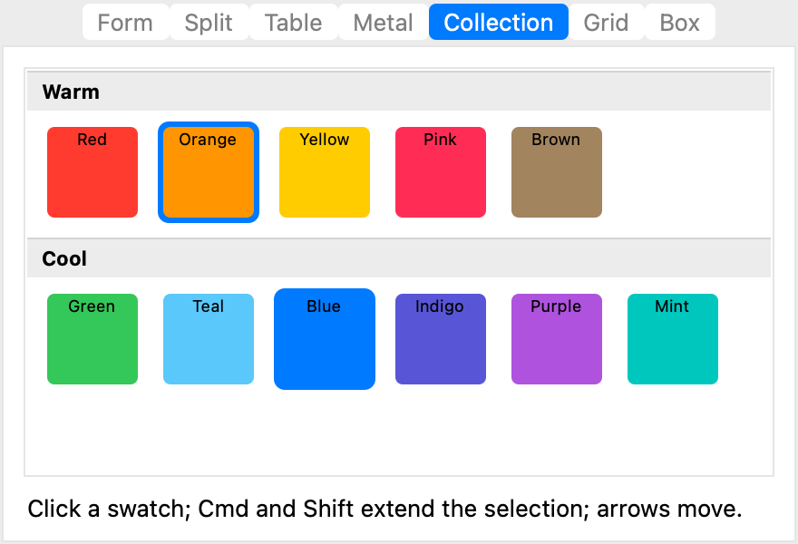 | 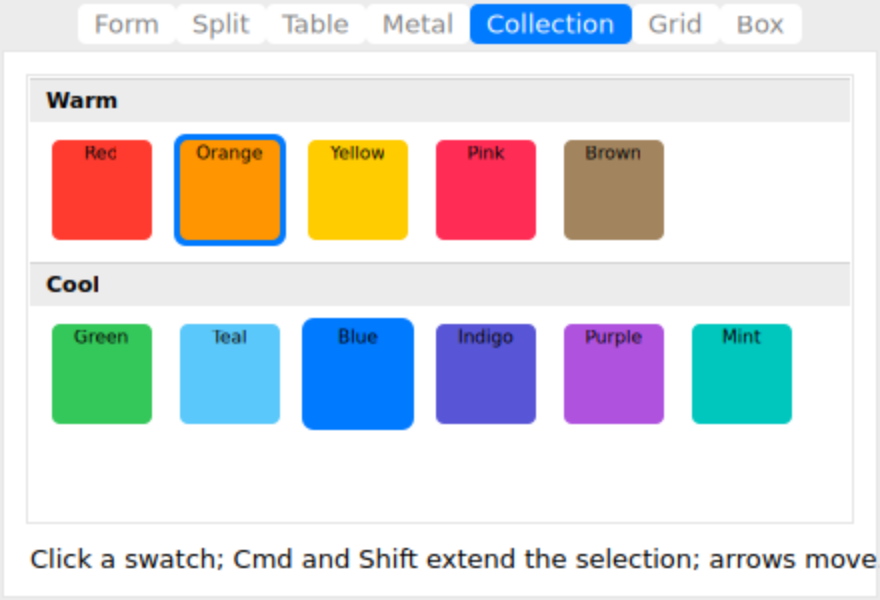 |  |
| Layout Demo, Grid tab: an `NSGridView` form with a merged title row and trailing labels | 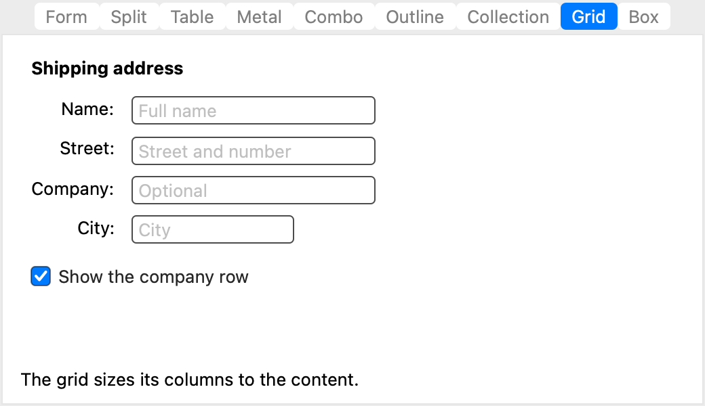 | 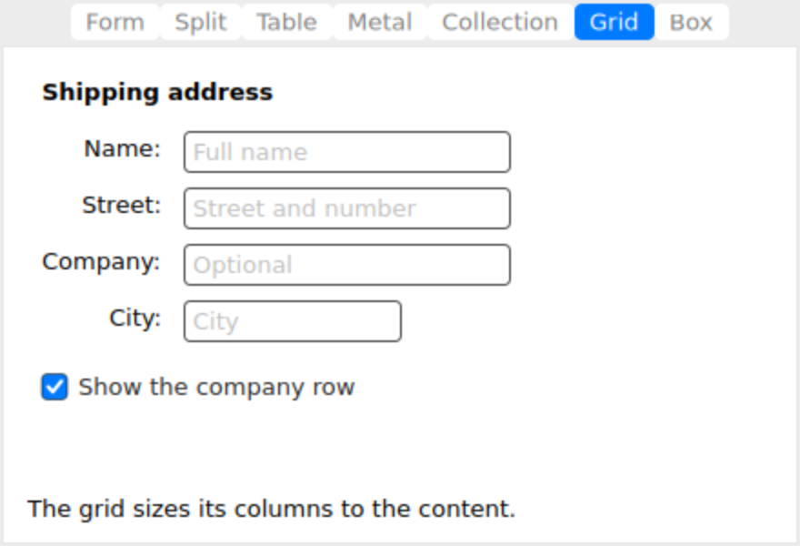 |  |
| Layout Demo, Box tab: `NSBox` types and title positions | 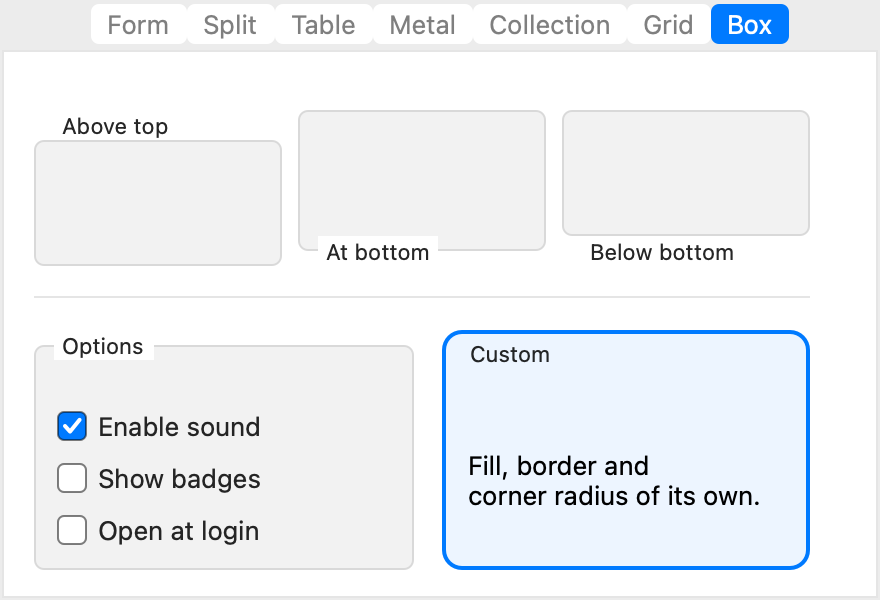 | 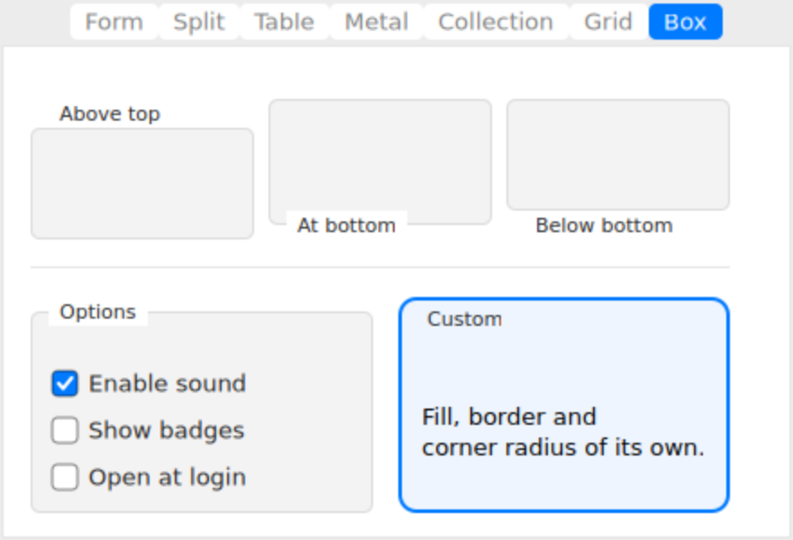 |  |
| Layout Demo, Combo tab: two `NSComboBox`es (one over its items with completion, one over a data source) | 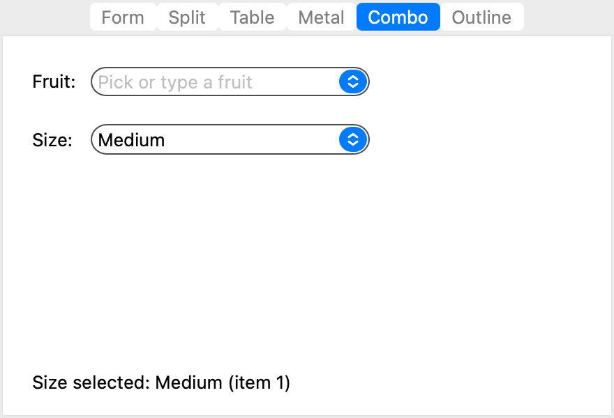 | 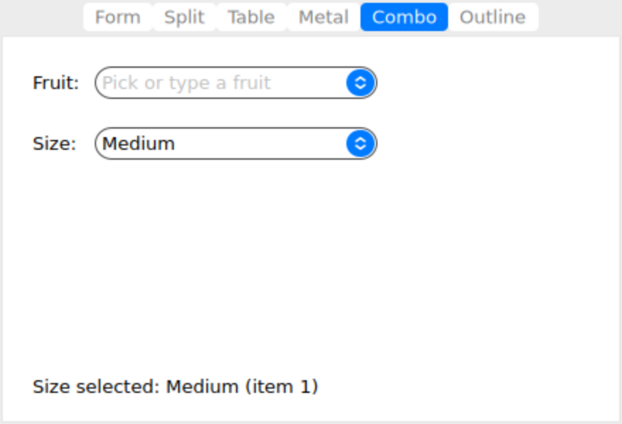 | awaiting a capture from the Windows machine |
| Layout Demo, Outline tab: an `NSOutlineView` with disclosure triangles and two columns | 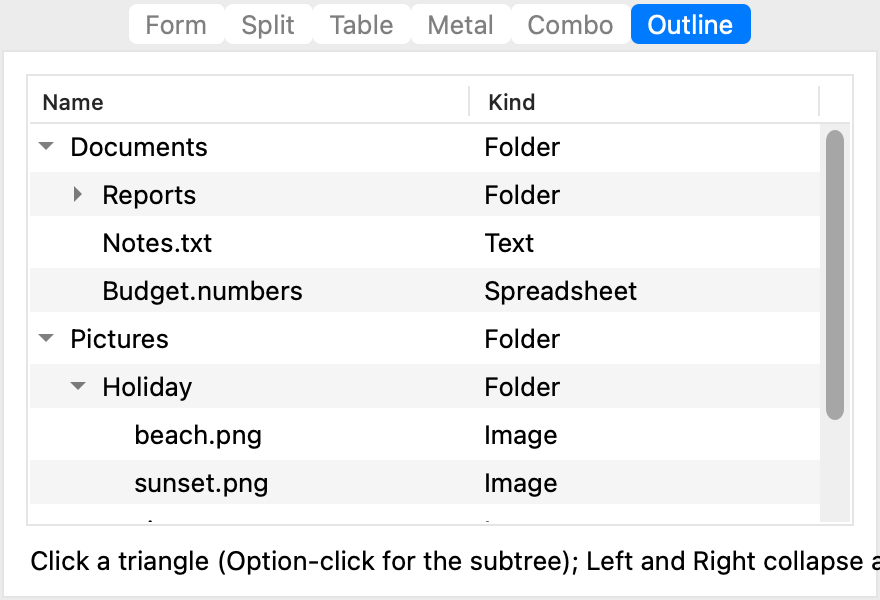 | 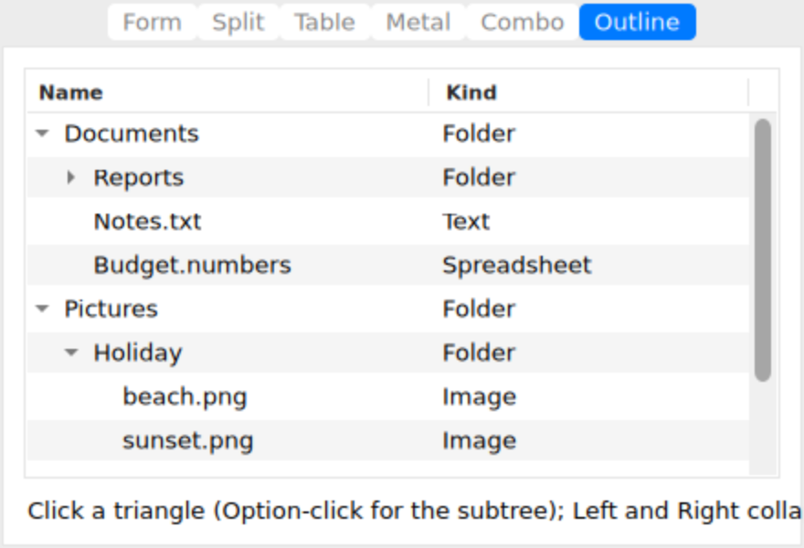 | awaiting a capture from the Windows machine |
| Outline tab right to left (`APPKITWIN_LAYOUT_DIRECTION=rtl`): columns, indentation and triangles mirror | 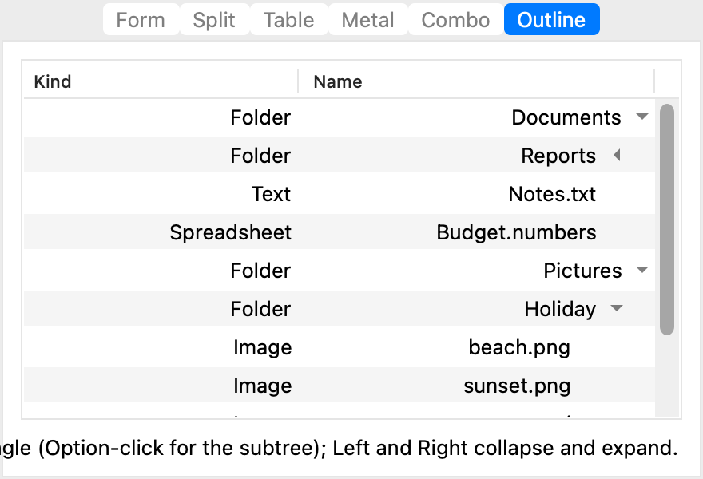 | 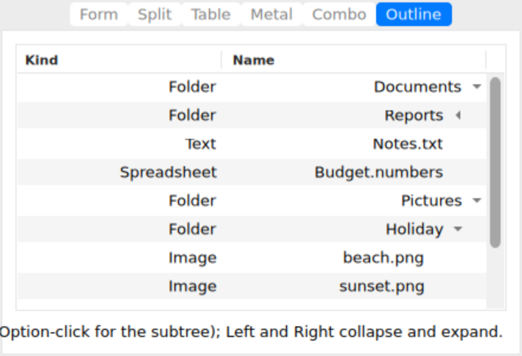 | awaiting a capture from the Windows machine |
| Layout Demo, Pages tab: an `NSPageController` over three pages (Back/Next, a segmented control through `takeSelectedIndexFrom:`, the transition style), pages that highlight under the pointer through `NSTrackingArea`; the window carries a trailing title bar accessory while the tab shows | 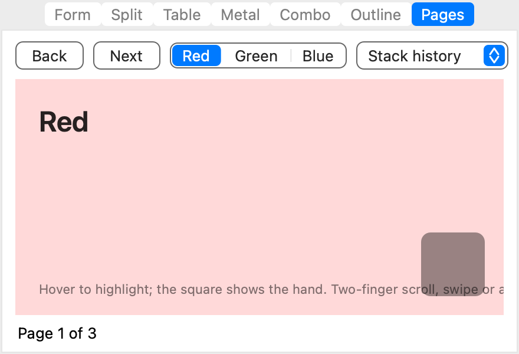 | 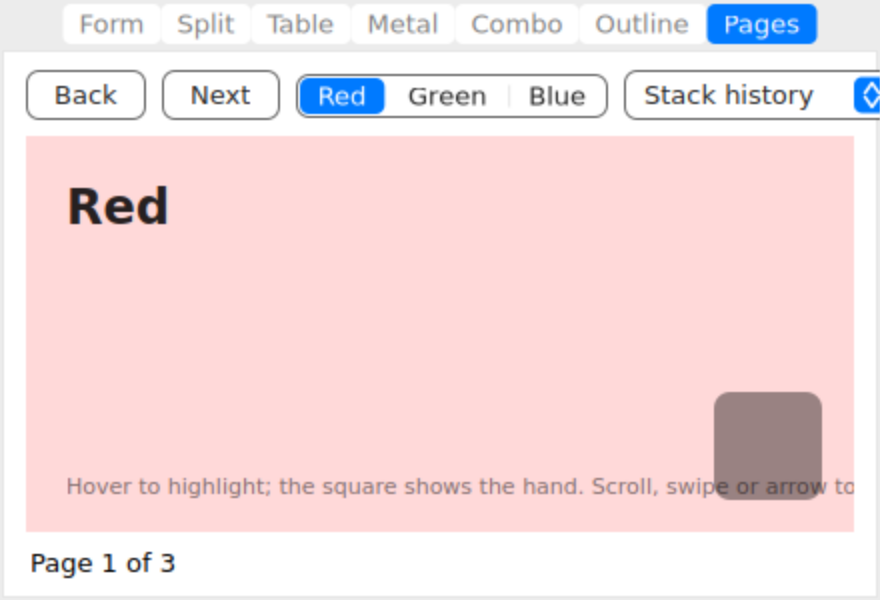 | awaiting a capture from the Windows machine |
| Layout Demo, Popover tab: a button per `NSPopover` behaviour and an `NSSwitch` | 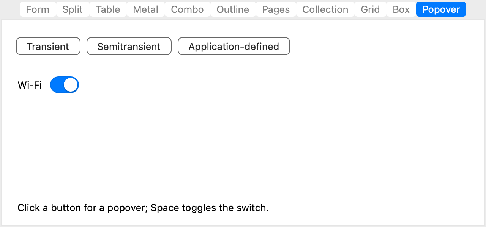 | 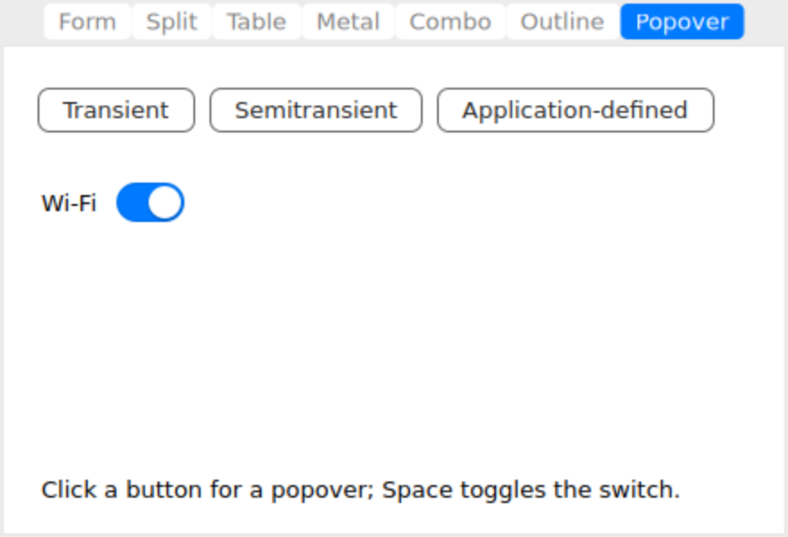 | awaiting a capture from the Windows machine |
| The transient popover's own window (`APPKITWIN_POPOVER_OPEN=1`): body, arrow, content | 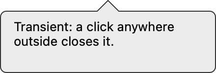 | 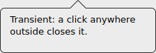 | awaiting a capture from the Windows machine |

What to look for:

- **Text**: all three go through CoreText (Apple's on macOS, the package's engines on Linux and
  Windows), so line breaks, baselines and advances match; glyph rasterisation differs by
  engine (Core Graphics, Cairo/FreeType, DirectWrite) and by the system font (Helvetica
  Neue / San Francisco on macOS, DejaVu Sans in the container, Segoe UI on Windows).
- **Paths and fills**: anti-aliasing and stroke joins come from Core Graphics, Cairo and
  Direct2D respectively; shapes, rounded rects and dashes should sit on the same pixels.
- **Controls**: drawn by the package's cells on every platform, so buttons, checkboxes,
  sliders and scrollers look the same everywhere; system colours follow the platform theme
  (the Windows captures are from a dark-themed PC).
- **Window frames**: the macOS images are headless renders of the content area (no window
  chrome); Linux shows the window manager's frame; Windows shows the DWM frame.

Regenerate the macOS and Linux columns with:

```bash
swift run HelloWindow --swiftui --layout --screenshot docs/images/compare   # macOS, headless
APPKITWIN_DEMO_TAB=data swift run HelloWindow --swiftui --screenshot docs/images/compare   # the Data tab
APPKITWIN_LAYOUT_TAB=combo swift run HelloWindow --layout --screenshot docs/images/compare   # the Combo tab (outline: APPKITWIN_LAYOUT_TAB=outline)
APPKITWIN_LAYOUT_TAB=popover APPKITWIN_POPOVER_OPEN=1 swift run HelloWindow --layout --screenshot docs/images/compare   # the Popover tab and the popover's window
docker run --rm -v "$PWD":/src -w /src appkitwin-linux bash tools/linux/compare.sh  # Linux, Xvfb
```

The combo box's list opens in a window of its own, which the headless renders do not
include; `tools/linux/compare.sh` also captures the X screen with the Fruit list open
(`APPKITWIN_COMBO_POPUP=1`):

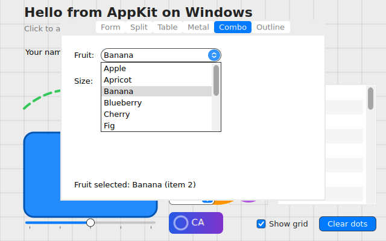

The transient popover open on the Layout Demo's Popover tab under Xvfb (the popover is a transient window of the demo's; X11 shows no transparency, so its surround is the parent's background colour):

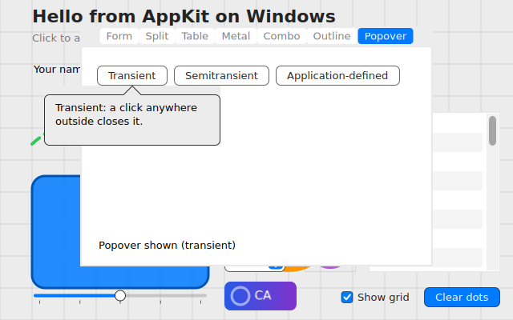

The Windows column is captured by the Windows test machine (window captures of the live
app). More Windows captures show the SwiftUI demo's other tabs and the menus, which are drawn
by the package in their own windows on every platform:

| Navigation tab | Presentation tab |
|---|---|
|  |  |

| Pop-up button open (selected item over the button) | SwiftUI Menu with a submenu |
|---|---|
|  |  |

Window frames on Wayland (ADR-0015): sway's server-side frame, and the package's own
client-side decorations (title band with the standard buttons, shadow, rounded corners,
resize edges) that every window gets on a compositor without xdg-decoration, such as
Mutter. Both from the headless sway in the container (`tools/linux/run-wayland.sh`):

| Server-side (sway) | Client-side (the package) |
|---|---|
|  |  |

A window toolbar (ADR-0018), drawn by the package under the title band on every backend:
image items with labels, a segmented group, a menu item, the selected item, a search field
and the standard Customize item, from `Examples/Toolbar` under Xvfb (X11, Cairo). Narrowing
the window moves items into a » menu; the status item is in the tray, not the window.

| Toolbar example (Linux) |
|---|
| 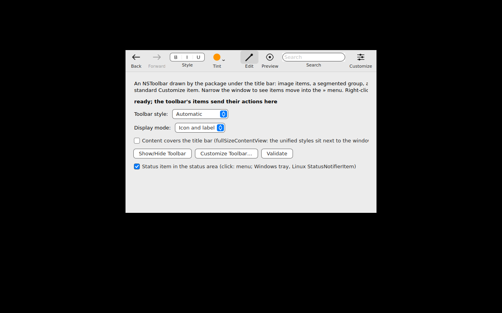 |

Metal on Linux (ADR-0012): the Layout Demo's Metal tab, an `MTKView` whose frames the Vulkan
device presents through a `VkSwapchainKHR` on a native surface the window places under the
view (a child window on X11, a subsurface on Wayland), from lavapipe in the container with
`HelloWindow --metal --metal-static` (`tools/linux/run.sh` and `run-wayland.sh`, which also
count the clear colour's pixels on screen). The device label the view carries as a subview
is under the surface on Linux, where Windows composites it above the swap chain.

| X11 (Xvfb) | Wayland (headless sway) |
|---|---|
| 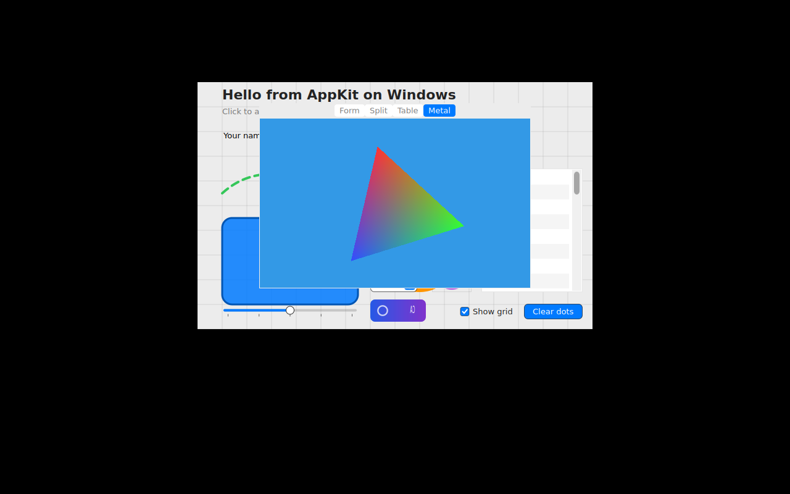 | 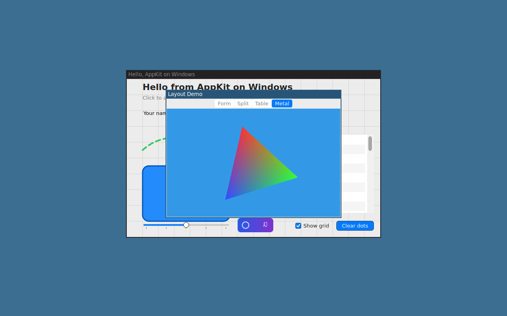 |

3D transforms with perspective in the software compositor (ADR-0005, "3D transforms"):
the Animation example's card mid-flip under a perspective `sublayerTransform`, drawn by
Cairo under Xvfb (`APPKITWIN_LINUX_BACKEND=x11 .build/debug/Animation`, captured with
`xwd` a few seconds in). The near edge is taller and the far edge shorter, as
DirectComposition draws it on Windows; before 2026-11-10 the software path drew the
affine part only, a plain horizontal squash (left, the earlier capture from the same
loop).

| Before: the affine part only (Linux, X11, Cairo) | After: the projection (Linux, X11, Cairo) |
|---|---|
| 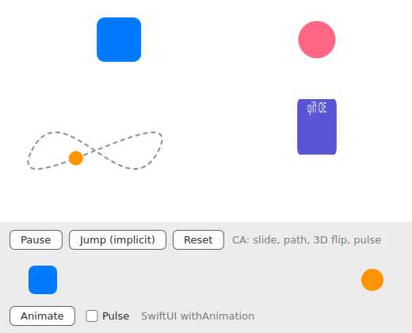 |  |
