# Side-by-side rendering comparisons

The same windows, drawn by the same AppKit and SwiftUI code, on each platform backend.
Every image is produced by the sample itself (`HelloWindow --screenshot <dir>` renders
each open window through the view hierarchy, the way the window draws it) or, on Windows,
by a capture of the live window.

| Window | macOS (host backend, Apple CoreGraphics + CoreText) | Linux (X11, Cairo + Pango/HarfBuzz) | Windows (Direct2D + DirectWrite) |
|---|---|---|---|
| HelloWindow main window: paths, text, controls, scroll view, the Core Animation badge | 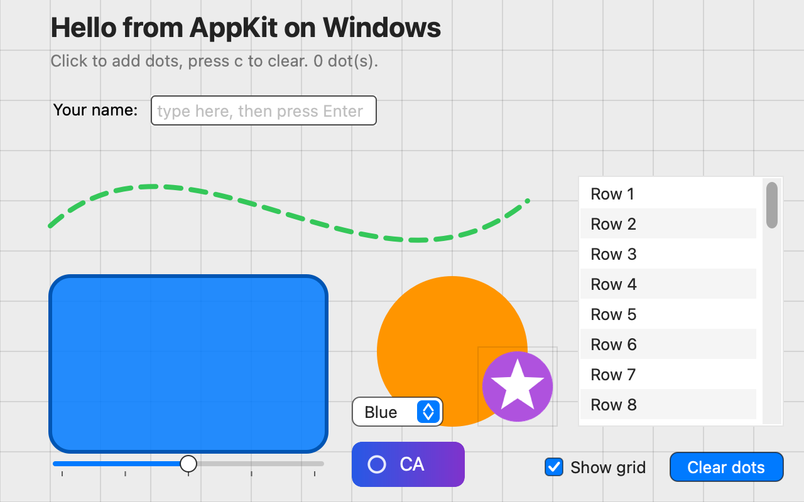 | 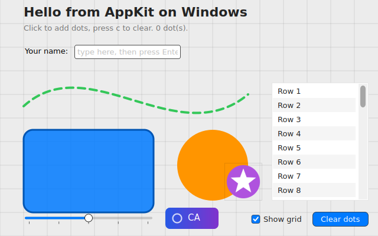 | 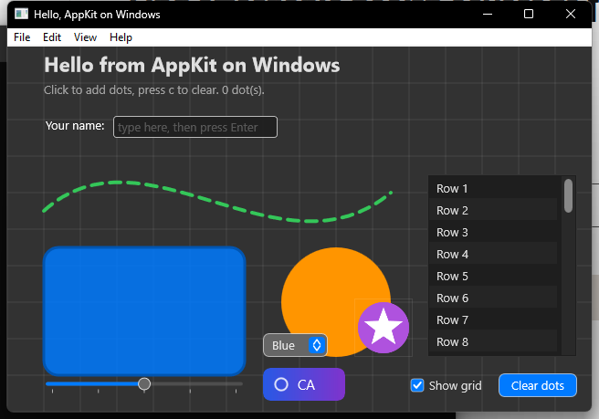 |
| Layout Demo, Form tab: Auto Layout, labels, text fields, buttons | 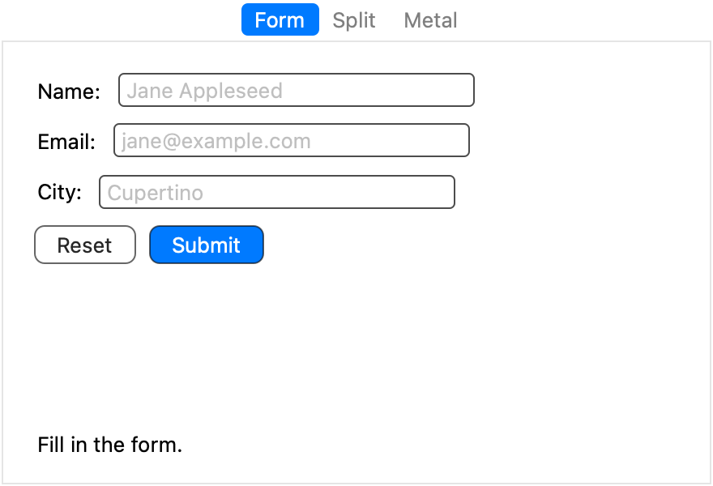 | 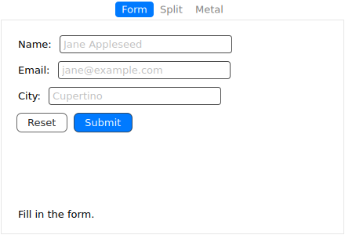 | 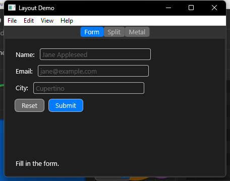 |
| SwiftUI demo, Controls tab: stacks, text, controls, shapes, list | 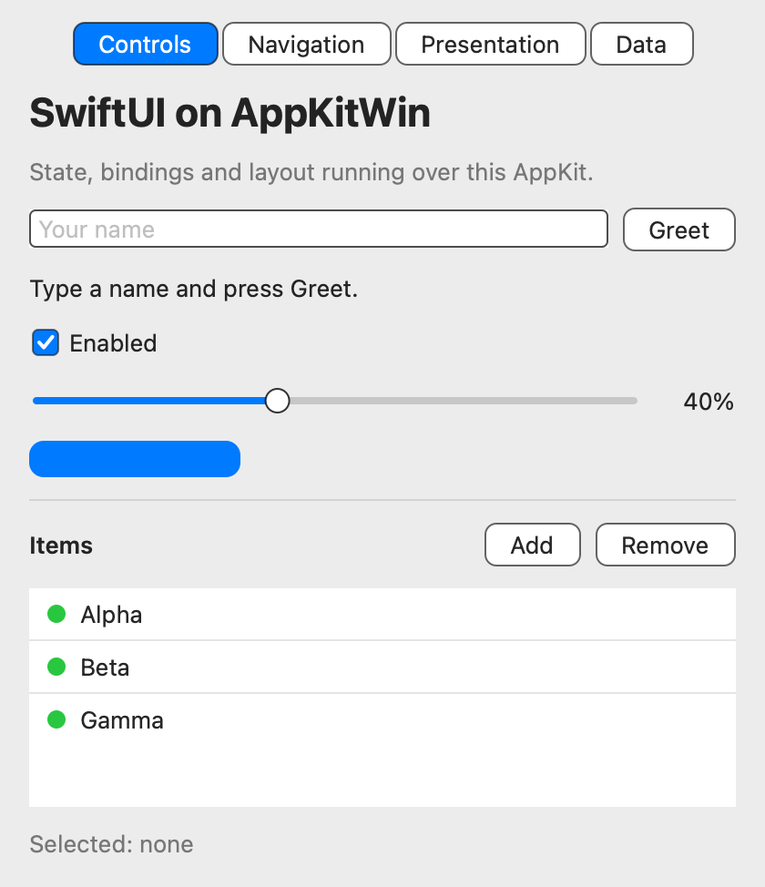 | 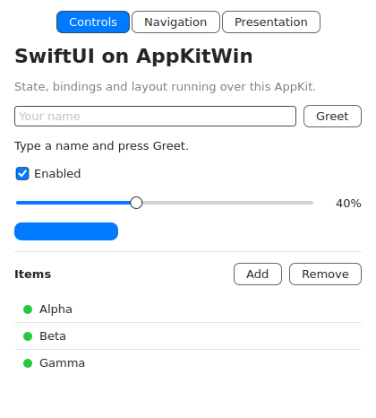 | 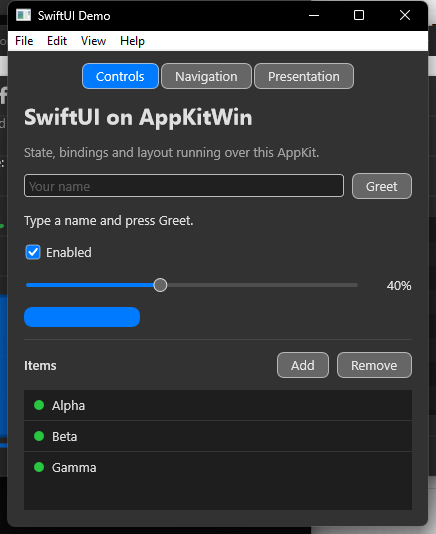 |
| SwiftUI demo, Data tab: a sortable Table with selection | 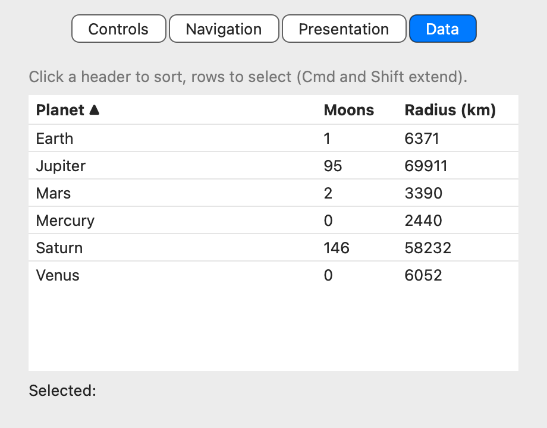 | 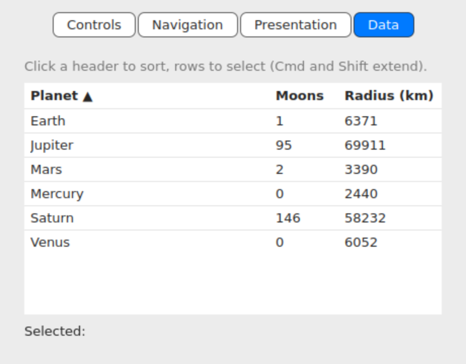 | 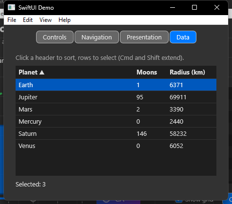 |

What to look for:

- **Text**: all three go through CoreText (Apple's on macOS, the package's engines on Linux and
  Windows), so line breaks, baselines and advances match; glyph rasterisation differs by
  engine (Core Graphics, Cairo/FreeType, DirectWrite) and by the system font (Helvetica
  Neue / San Francisco on macOS, DejaVu Sans in the container, Segoe UI on Windows).
- **Paths and fills**: anti-aliasing and stroke joins come from Core Graphics, Cairo and
  Direct2D respectively; shapes, rounded rects and dashes should sit on the same pixels.
- **Controls**: drawn by the package's cells on every platform, so buttons, checkboxes,
  sliders and scrollers look the same everywhere; system colours follow the platform theme
  (the Windows captures are from a dark-themed PC).
- **Window frames**: the macOS images are headless renders of the content area (no window
  chrome); Linux shows the window manager's frame; Windows shows the DWM frame.

Regenerate the macOS and Linux columns with:

```bash
swift run HelloWindow --swiftui --layout --screenshot docs/images/compare   # macOS, headless
APPKITWIN_DEMO_TAB=data swift run HelloWindow --swiftui --screenshot docs/images/compare   # the Data tab
docker run --rm -v "$PWD":/src -w /src appkitwin-linux bash tools/linux/compare.sh  # Linux, Xvfb
```

The Windows column is captured by the Windows test machine (window captures of the live
app). More Windows captures show the SwiftUI demo's other tabs and the menus, which are drawn
by the package in their own windows on every platform:

| Navigation tab | Presentation tab |
|---|---|
| 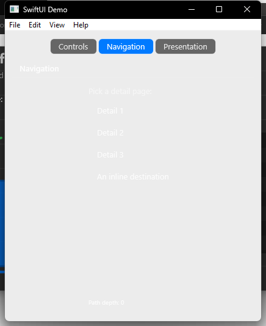 | 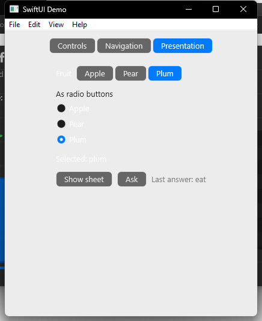 |

| Pop-up button open (selected item over the button) | SwiftUI Menu with a submenu |
|---|---|
| 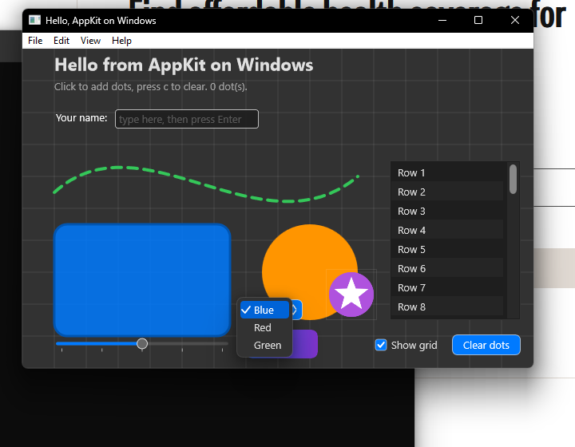 | 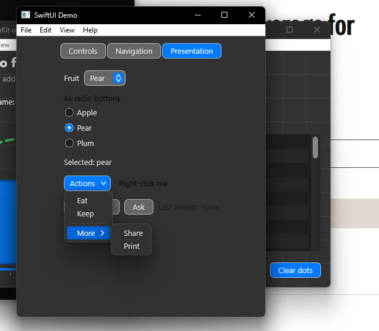 |

Window frames on Wayland (ADR-0015): sway's server-side frame, and the package's own
client-side decorations (title band with the standard buttons, shadow, rounded corners,
resize edges) that every window gets on a compositor without xdg-decoration, such as
Mutter. Both from the headless sway in the container (`tools/linux/run-wayland.sh`):

| Server-side (sway) | Client-side (the package) |
|---|---|
| 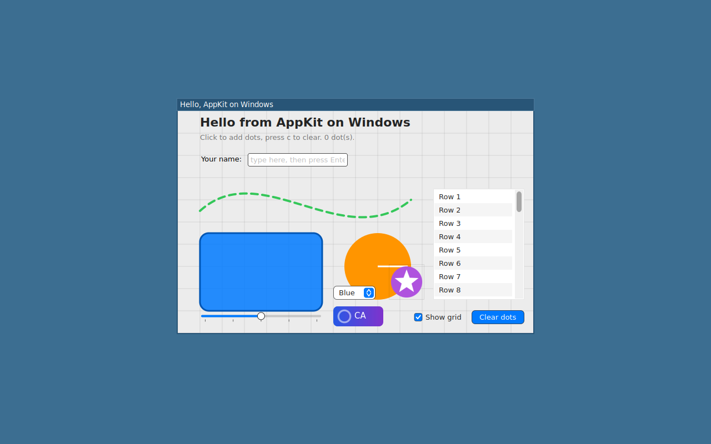 | 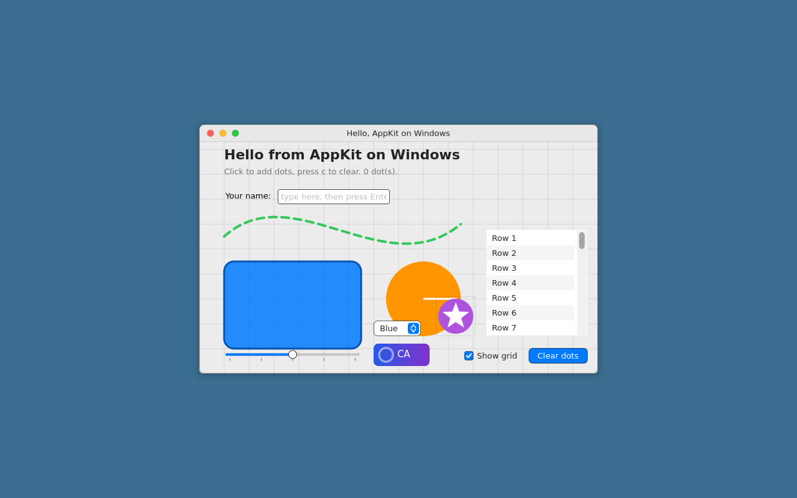 |

3D transforms with perspective in the software compositor (ADR-0005, "3D transforms"):
the Animation example's card mid-flip under a perspective `sublayerTransform`, drawn by
Cairo under Xvfb. The near edge is taller and the far edge shorter, as DirectComposition
draws it on Windows; before 2026-11-10 the software path drew the affine part only, a
plain horizontal squash.

| Animation example, flip card mid-flip (Linux, X11, Cairo) |
|---|
| 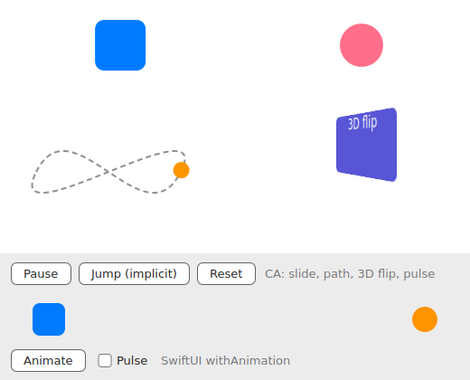 |
