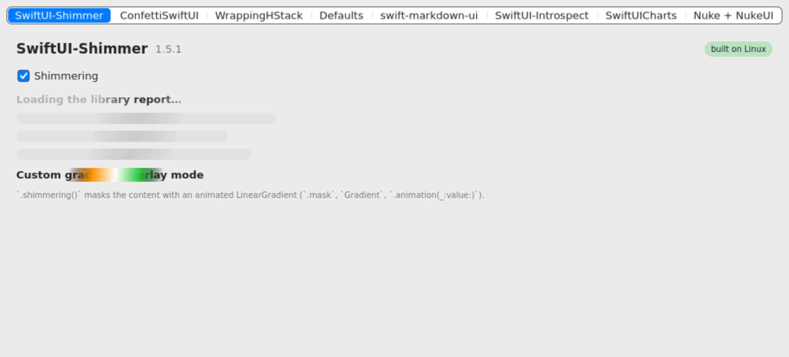
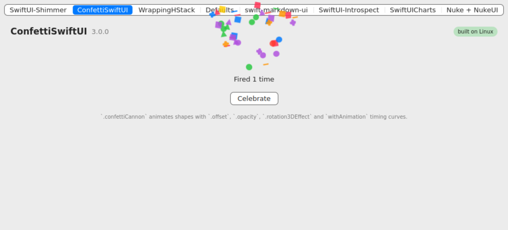
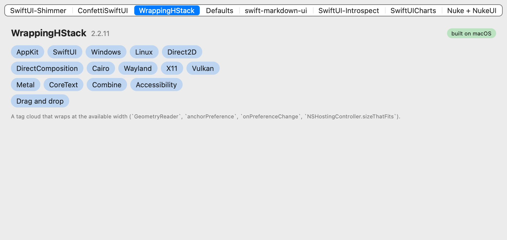
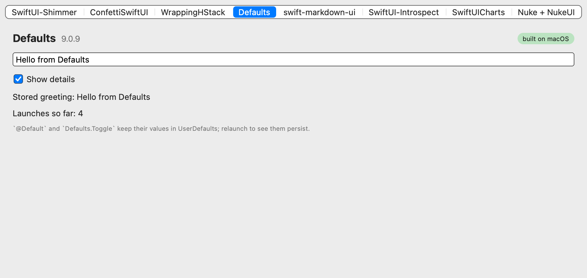

# Third-party SwiftUI libraries on AppKitWin

How eight popular open-source SwiftUI packages fare when built against this package's
`SwiftUI` instead of Apple's, measured by `Examples/LibraryCompat` (one tab per library)
and `tools/library-compat.sh --probe` (each library built on its own, first error
recorded). The point of the exercise is the last section: the concrete API gaps the
libraries ran into, which are the port's to-do list for library compatibility.

"macOS" below means the macOS host build compiling the library against AppKitWin's
SwiftUI (the script raises every deployment target to 14.0 so the compiler accepts the
mix), not Apple's SwiftUI, where all of them build by definition. Results as of
2026-11-04, Swift 6.2 on macOS and in the Linux container, Swift 6.2/6.4 on Windows.

## Verdicts

| Library | Version | Builds: macOS / Windows / Linux | Runs | What is wrong |
| --- | --- | --- | --- | --- |
| [SwiftUI-Shimmer](https://github.com/markiv/SwiftUI-Shimmer) | 1.5.1 | yes / pending / yes | yes | The band animates over the masked content on Linux and macOS (`.mask` of an animated `LinearGradient`); the `.overlay(blendMode:)` mode draws the gradient over the text because compositing blend modes are not applied yet. |
| [ConfettiSwiftUI](https://github.com/simibac/ConfettiSwiftUI) | 3.0.0 | yes / pending / yes | yes | Confetti bursts, falls, spins (`.rotation3DEffect`) and fades (Linux screenshot below; the macOS host is headless and its capture only shows the counter). Haptics are `#if canImport(UIKit)` and skipped. |
| [WrappingHStack](https://github.com/dkk/WrappingHStack) | 2.2.11 | yes / no / no | yes (macOS) | `#if os(macOS)` … `#else UIHostingController`: on Windows and Linux the first error is `cannot find 'UIHostingController' in scope` (WrappingHStack.swift:78). Needs an upstream `canImport(AppKit)` check. On macOS the tag cloud wraps correctly once `Text` stopped breaking inside words. |
| [Defaults](https://github.com/sindresorhus/Defaults) | 9.0.9 | yes / no / no | yes (macOS) | Same `#if os(macOS)` / `#else import UIKit` (Defaults+Bridge.swift:5). The macOS build stores and reads keys through `@Default` and `Defaults.Toggle`; on Windows and Linux it would also meet corelibs Foundation without KVO on `UserDefaults`. |
| [swift-markdown-ui](https://github.com/gonzalezreal/swift-markdown-ui) | 2.4.1 | no / no / no | — | Its `NetworkImage` dependency now builds (it needed `.task`, `.redacted`, `Image(decorative:scale:)`, `StateObject` isolation) but on Linux first fails on `URLResponse` being in `FoundationNetworking` (NetworkImageLoader.swift:21); `MarkdownUI` itself has 656 errors on macOS: `Font.Width`, `Text.LineStyle`, the `Layout` protocol (`Subviews`), `AnyShapeStyle`, `AttributeContainer` SwiftUI attributes, `@ScaledMetric`, `Grid`, … (the gap list). |
| [SwiftUI-Introspect](https://github.com/siteline/swiftui-introspect) | 27.1.0 | no / no / no | — | Linux and Windows: `no such module 'ObjectiveC'` (IntrospectionView.swift:214), then `NSView.subviews` walks of Apple's private hierarchy. macOS host build: the SDK's MapKit/WebKit/AVKit view types fail `PlatformEntity` (520 errors) and `swift-frontend` crashes on `MKMapView` in emit-module. By design it reaches into AppKit internals; not a target for the port. |
| [SwiftUICharts](https://github.com/willdale/SwiftUICharts) | 2.10.4 | no / no / no | — | Windows and Linux: `no such module 'CoreGraphics.CGGeometry'` (BarLayout.swift:8; the port's CoreGraphics has no submodules). macOS: 818 errors, `Gradient`/`LinearGradient` now present, still `GridItem`/`LazyVGrid`, `.position`, `.zIndex`, `InsettableShape`, `Shape.trim`/`scale`, `Path.trimmedPath`/`addRelativeArc`/`forEach`, `.gesture`, `accessibilityElement`, `Text` with `specifier:`. |
| [Nuke + NukeUI](https://github.com/kean/Nuke) | 13.2.1 | no / no / no | — | Windows and Linux: `#if !os(macOS) import UIKit` (ImageCache.swift:7). macOS: `CIImage`/`CIFilter` (no Core Image), the ImageIO C API (`CGImageSourceCreateWithData`, `kCGImageSourceShouldCache`, `CGImagePropertyOrientation`: the port has `CGImageSource` as a class, not the C functions), `NSImage`/`NSColor` not `Sendable`, `Image(cgImage, scale:)` label arguments. |

Shimmer on Linux (X11 under Xvfb) and macOS, confetti on Linux, the tag cloud and Defaults on
macOS (`LibraryCompat --screenshot`, `tools/linux/run.sh`):

<table>
  <tr>
    <td></td>
    <td></td>
  </tr>
  <tr>
    <td></td>
    <td></td>
  </tr>
</table>

Windows: pending the Windows machine's run of the checklist (build, run, one screenshot per
tab); this table is updated with its report.

## How the example is built

The third-party packages do not depend on AppKitWin, so three things are needed before
`import SwiftUI` in one of them resolves to the port (all in `tools/library-compat.sh`):

1. AppKitWin's `SwiftUI` (and on Windows and Linux `ImageIO`) must already be in the
   build's `Modules` directory: `swift build --target SwiftUI`, then `swift build`.
2. Every compile gets the C shim module maps (`-Xcc -fmodule-map-file=…` for `CCairo`,
   `CD2D`, …) and on Linux the pkg-config include paths, because a client of `AppKit`
   needs the clang modules it imports and SwiftPM passes them only to declared dependents.
3. On macOS every target's deployment target is raised to 14.0 (the libraries declare
   10.15–12, the host build's modules 14).

A library that fails to build stays declared in `Examples/LibraryCompat/Package.swift` so
the probe can re-check it; only the ones that compile are linked into the app on each
platform, and the app shows the exclusion reason on the library's tab.

## Fixed in the port for this example

Each with a test in `Tests/AppKitTests/SwiftUIEffectsTests.swift` unless noted:

- `Gradient`, `Gradient.Stop`, `LinearGradient` as a `View` and a `ShapeStyle`
  (`Shape.fill(_ style:)`), drawn as bands since CoreGraphics on Windows and Linux has no
  `CGGradient`; the end points animate under `.animation(_:value:)` (Shimmer).
- `.mask(_:)` and `.mask(alignment:_:)`: the mask hierarchy is rendered offscreen into the
  backing layer's mask (Shimmer).
- `PreferenceKey`, `.preference`, `.anchorPreference`, `.transformPreference`,
  `.onPreferenceChange`, `Anchor.Source` (`.bounds`, `.rect`, `.point`, `.unitPoint`, …)
  resolved after layout and converted by `GeometryProxy[anchor]`; delivered inside the
  layout pass so a `frame(height:)` fed by a preference settles in one pass (WrappingHStack).
- `.rotation3DEffect(_:axis:anchor:anchorZ:perspective:)` on the layer's 3D transform,
  animatable (ConfettiSwiftUI).
- `.task` and `.task(id:)`, `.redacted(reason:)`/`.unredacted()`/`RedactionReasons`,
  `Image(_:scale:orientation:label:)` and `Image(decorative:scale:orientation:)` from a
  `CGImage`, `NSImage()` (NetworkImage).
- `Color(cgColor:)`, `Color(_ cgColor:)`, `Color(_ nsColor:)`, `Color.cgColor`,
  `Color.Resolved` with `resolve(in:)`, `NSColor(_ color: Color)`, `Label` with
  `StringProtocol` titles (Defaults).
- `View`, `ObservedObject`, `StateObject` and `PreviewProvider` are main-actor isolated as
  Apple's are, so `@StateObject private var model = MainActorModel()` and `static var
  previews` compile (NetworkImage, every library's `#if DEBUG` previews); `PreviewProvider`,
  `PreviewLayout`, `.previewLayout`, `.previewDisplayName`.
- `.blendMode(_:)` and `BlendMode`: accepted and set as the layer's compositing filter, which
  the compositors do not apply yet (Shimmer's overlay mode draws the gradient opaque).
- `Text` never breaks inside a word: a proposal narrower than its widest word is answered
  with that word's width, as SwiftUI does, so stacks with spacers no longer squeeze tags
  into columns of letters (WrappingHStack; `SwiftUILibraryIdiomTests`).
- Custom `DynamicProperty` wrappers have their own dynamic properties installed (a wrapper
  around `@ObservedObject` such as Defaults' `@Default` now refreshes the view).

## API gaps found (not fixed)

Listed in `docs/ROADMAP.md` as follow-ups; the concrete members, by the library that hit them:

swift-markdown-ui (656 errors after NetworkImage builds):
- `Layout` protocol and friends: `Layout`, `Subviews`, `LayoutSubviews`, `AlignmentID`,
  `ViewDimensions`, `VerticalAlignment.init(_:)` with a custom ID, `Grid`, `GridRow`,
  `.gridColumnAlignment`.
- `Font.Width`, `Font.width(_:)`, `Font.smallCaps()`/`lowercaseSmallCaps()`/
  `uppercaseSmallCaps()`, `Text.LineStyle`, `Text.monospacedDigit()`, `.lineSpacing(_:)`,
  `@ScaledMetric`, `Text(_:)` from an `Image`-interpolated string.
- `AttributedString` SwiftUI attributes (`AttributeScopes.SwiftUIAttributes`: `font`,
  `foregroundColor`, `backgroundColor`, `underlineStyle`, `strikethroughStyle`, `kern`,
  `tracking`) and `Text(AttributedString)` honouring them.
- `AnyShapeStyle`, `.labelStyle`/`LabelStyle` (`.titleAndIcon`), `.symbolRenderingMode`,
  `.imageScale`, `.transformEnvironment`, `.backgroundPreferenceValue`,
  `.overlayPreferenceValue`, `.alignmentGuide`.
- Linux: `URLResponse`/`URLSession` live in `FoundationNetworking` on corelibs; libraries
  that only `import Foundation` fail there (not an AppKitWin gap, but hits every networking
  library).

SwiftUICharts (818 errors):
- `GridItem`, `LazyVGrid`, `.position(_:)`/`.position(x:y:)`, `.zIndex`, `InsettableShape`,
  `Shape.trim(from:to:)`, `Shape.scale`, `Path.trimmedPath`, `Path.addRelativeArc`,
  `Path.forEach`, `.gesture(_:)` (`DragGesture`), `.accessibilityElement(children:)`,
  `Text(_:specifier:)`, `RadialGradient`/`AngularGradient`.
- `import CoreGraphics.CGGeometry` (a submodule import; the port's `CoreGraphics` is one
  module).

Nuke / NukeUI:
- Core Image (`CIImage`, `CIFilter`) has no counterpart; the ImageIO C API
  (`CGImageSourceCreateWithData`, `CGImageSourceCreateThumbnailAtIndex`,
  `CGImageSourceCopyPropertiesAtIndex`, `kCGImageSource…`/`kCGImageProperty…` keys,
  `CGImagePropertyOrientation`) is not exposed (the port has the `CGImageSource` class).
- `NSImage` and `NSColor` are not `Sendable` (Apple's are, as Objective-C classes).

SwiftUI-Introspect:
- No `ObjectiveC` module on Windows and Linux; `NSView.subviews`/`superview` walks of
  AppKit's private view hierarchy (what the library is for).

WrappingHStack, Defaults, Nuke:
- Upstream `#if os(macOS)` / `#else` (UIKit) switches; `canImport(AppKit)` would let them
  build here. Nothing the port can do.

Compositing:
- `.blendMode` is not applied by the software or DirectComposition compositors.
- `CGGradient` in CoreGraphics on Windows and Linux would replace the banded gradient
  drawing.
